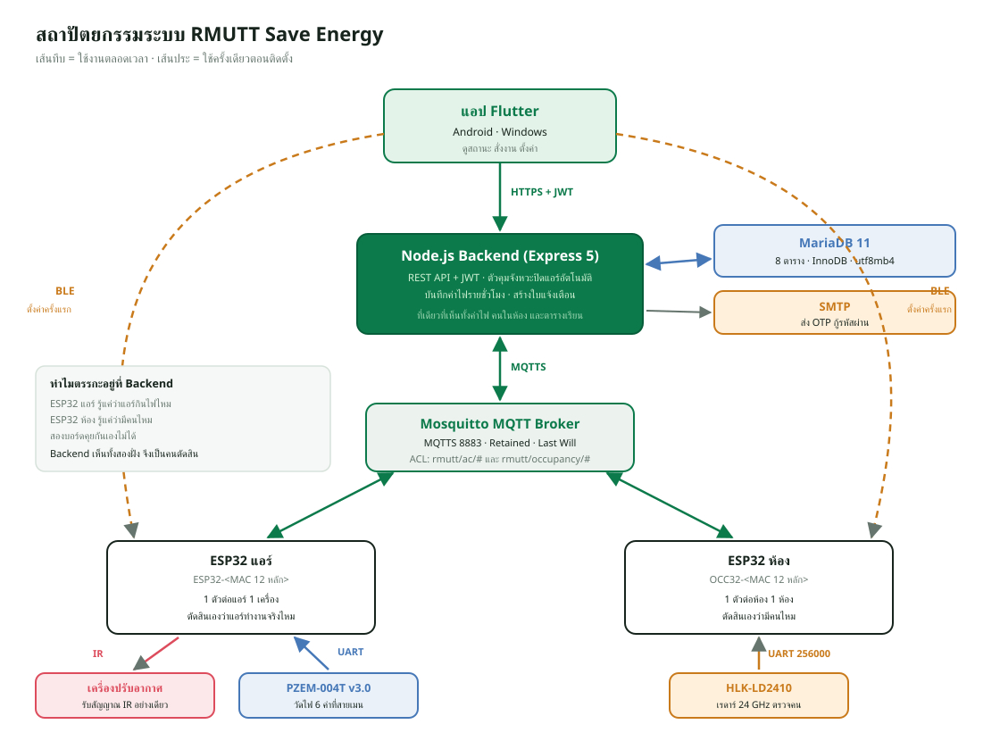

# 00 · ภาพรวมระบบ RMUTT Save Energy

> เอกสารชุดนี้เขียนเพื่ออธิบาย **เหตุผลเบื้องหลังการออกแบบ** ไม่ใช่แค่บอกว่ามีอะไร
> ทุกหัวข้อจะพยายามตอบว่า "ทำไมถึงเลือกทำแบบนี้" และ "ถ้าทำอีกแบบจะพังตรงไหน"
>
> อ่านเรียงตามลำดับไฟล์ได้ หรือกระโดดไปเฉพาะส่วนที่สนใจก็ได้
>
> ปรับให้ตรงกับโค้ดล่าสุด 14 ต.ค. 2569 (แอป 3.16.0+32 · เฟิร์มแวร์แอร์ IR 2.5.1 · สายแอร์ Daikin 2.5.2-slm8 · ตรวจคน 1.3.2)

| ไฟล์ | เนื้อหา |
|---|---|
| `00-system-overview.md` | ภาพรวม ปัญหาที่แก้ และเหตุผลของการแบ่งส่วน (ไฟล์นี้) |
| `01-database.md` | ฐานข้อมูล ทุกตาราง ทุกคอลัมน์ พร้อมเหตุผล |
| `02-backend.md` | Node.js + Express ชั้น route / service / util |
| `03-flutter-app.md` | แอปมือถือ สถาปัตยกรรม state และการแปลภาษา |
| `04-esp32-firmware.md` | เฟิร์มแวร์ ESP32 สามแบบ: แอร์ IR, แอร์สาย Daikin SLM8, ตรวจคน LD2410 |
| `05-mqtt-ble.md` | โปรโตคอลคุยกับอุปกรณ์ และขั้นตอน provisioning |
| `06-auto-off.md` | ระบบปิดแอร์อัตโนมัติ เครื่องสถานะและกติกากันพลาด |
| `07-energy-export.md` | การเก็บค่าไฟรายชั่วโมงและการส่งออก Excel |
| `08-deploy-security.md` | การนำขึ้นเซิร์ฟเวอร์จริงและความปลอดภัย |

ภาพประกอบอยู่ในโฟลเดอร์ `img/`

---

## 1. ปัญหาที่ระบบนี้แก้

อาคาร 16 คณะวิศวกรรมศาสตร์ มทร.ธัญบุรี มีห้องเรียนและห้องทำงานรวมกว่า 20 ห้อง
แต่ละห้องมีเครื่องปรับอากาศ ปัญหาที่เจอจริงคือ

1. **แอร์เปิดทิ้งไว้ตอนไม่มีคน** — คนสุดท้ายออกจากห้องแล้วลืมปิด
   ค่าไฟเดินต่อทั้งคืนหรือทั้งวันหยุดโดยไม่มีใครรู้
2. **ไม่รู้ว่าห้องไหนกินไฟเท่าไร** — มีแต่บิลรวมของทั้งอาคาร
   แยกไม่ออกว่าควรไปแก้ที่ห้องไหนก่อน
3. **ไม่มีใครเดินไปดูได้ตลอด** — อาคารสามชั้น คนดูแลมีจำกัด

ระบบนี้จึงต้องทำสามอย่างพร้อมกัน **วัดไฟรายเครื่อง** · **รู้ว่ามีคนอยู่ไหม** ·
**สั่งปิดได้เอง** และต้องดูย้อนหลังได้ว่าประหยัดไปเท่าไร

---

## 2. ทำไมต้องแยกเป็น 4 ส่วน



```
แอป Flutter ──BLE──────────────> ESP32 (ตั้งค่าครั้งแรกเท่านั้น)
     │
     │ HTTPS + JWT
     ▼
Node.js Backend ──> MariaDB
     │              SMTP (ส่ง OTP)
     │
     │ MQTTS (บอร์ดต่อผ่าน Tailscale Funnel พอร์ต 8443 เป็นค่าเริ่มต้น)
     ▼
Mosquitto Broker
     ├──> ESP32 แอร์  ──IR──> เครื่องปรับอากาศ
     │                ──PZEM──> วัดไฟที่สายเมน
     ├──> ESP32 สายแอร์ ──สายแอร์ SLM8──> แอร์ Daikin (แทนรีโมตติดผนัง)
     └──> ESP32 ห้อง  ──UART──> HLK-LD2410 (เรดาร์ตรวจคน)
```

(อัปเดต 14 ต.ค. 2569) ตั้งแต่ 11 ต.ค. มีบอร์ดแอร์แบบที่สาม `rmutt_esp32_air_wired`
ต่อสายแอร์ Daikin แทนรีโมตติดผนัง ใช้ topic และ API ชุดเดียวกับบอร์ด IR
ทุกอย่าง ต่างกันแค่ช่องทางที่สั่งแอร์ (ดู `04-esp32-firmware.md`)

### ทำไมไม่ให้แอปคุยกับ ESP32 ตรง ๆ ตลอดเวลา

เคยคิดจะให้แอปสั่งบอร์ดผ่าน BLE หรือ HTTP ในวง LAN โดยตรง แต่มีปัญหาสามข้อ

- **แอปไม่ได้เปิดอยู่ตลอด** ถ้าตรรกะปิดแอร์อัตโนมัติอยู่ในแอป ปิดแอปแล้วระบบก็ตาย
- **อยู่นอกมหาวิทยาลัยก็ต้องใช้ได้** BLE ไปได้ไม่เกิน 10 เมตร
- **ต้องมีที่เก็บประวัติ** มือถือเครื่องเดียวเก็บค่าไฟของทั้งอาคารไม่ไหว
  และถ้าเปลี่ยนเครื่องข้อมูลก็หาย

BLE จึงถูกใช้ **ครั้งเดียวตอนติดตั้ง** เพื่อบอกบอร์ดว่า Wi-Fi ชื่ออะไร
รหัสอะไร Broker อยู่ที่ไหน หลังจากนั้นบอร์ดคุยกับ Broker เองตลอด

### ทำไมตรรกะปิดแอร์ต้องอยู่ที่ Backend ไม่ใช่ที่บอร์ด

**เพราะเซ็นเซอร์ตรวจคนกับบอร์ดแอร์เป็นคนละตัว** และอยู่คนละที่ในห้อง

- `ESP32 แอร์` รู้ว่าแอร์กินไฟอยู่ไหม แต่ไม่รู้ว่ามีคนไหม
- `ESP32 ห้อง` รู้ว่ามีคนไหม แต่ไม่รู้ว่าแอร์ทำงานอยู่ไหม

จะให้สองบอร์ดคุยกันเองก็ได้ แต่ต้องเขียนโปรโตคอลระหว่างบอร์ดเพิ่ม
และถ้าบอร์ดหนึ่งดับ อีกบอร์ดก็ไม่รู้ว่าควรทำอะไร **Backend เป็นที่เดียวที่เห็น
ทั้งสองฝั่งพร้อมกัน** และเห็นตารางเรียนด้วย จึงเป็นที่ที่ควรตัดสินใจ

รายละเอียดอยู่ใน `06-auto-off.md`

### ทำไมต้องมี MQTT ไม่ใช้ HTTP ให้จบ

ESP32 ต้อง **รับคำสั่งได้ทันที** เมื่อมีคนกดปุ่มในแอป ถ้าใช้ HTTP บอร์ดต้องคอย
ยิงถามเซิร์ฟเวอร์ทุกไม่กี่วินาที (polling) ซึ่งเปลือง Wi-Fi เปลืองไฟ และยังช้า

MQTT เปิดการเชื่อมต่อค้างไว้เส้นเดียว เซิร์ฟเวอร์ push ลงมาได้ทันที
และได้ของแถมที่สำคัญมากสองอย่าง

| ความสามารถ | ใช้ทำอะไรในระบบนี้ |
|---|---|
| **Retained message** | ข้อความล่าสุดค้างอยู่บน Broker ใครต่อเข้ามาใหม่ได้ค่าล่าสุดทันที ใช้กับ `status` และ `schedule-status` |
| **Last Will (LWT)** | บอร์ดหลุดไฟ Broker ส่ง `online:false` แทนให้เอง ไม่ต้องรอ timeout เอง |

---

## 3. ทำไมเลือกเครื่องมือแต่ละตัว

### MariaDB ไม่ใช่ MongoDB

ข้อมูลในระบบนี้ **มีความสัมพันธ์ชัดเจนและต้องบังคับความถูกต้อง**

- แอร์หนึ่งเครื่องต้องอยู่ในห้องที่มีจริงเท่านั้น
- หนึ่งห้องมีเซ็นเซอร์ตรวจคนได้ไม่เกินหนึ่งตัว
- ตำแหน่ง (ห้อง, ลำดับแอร์) ห้ามซ้ำ

กติกาพวกนี้เขียนเป็น `FOREIGN KEY` และ `UNIQUE KEY` ได้ตรง ๆ
ฐานข้อมูลจะปฏิเสธข้อมูลผิดให้เองแม้โค้ดจะพลาด ถ้าใช้ฐานข้อมูลแบบเอกสาร
ต้องไปเขียนตรวจเองในโค้ดทุกจุด ซึ่งวันหนึ่งจะลืม

### Node.js + Express 5 (ESM)

- ทีมเขียน JavaScript อยู่แล้ว ลดภาษาที่ต้องดูแล
- งานหลักของ Backend คือ **รอ I/O** (ฐานข้อมูล, MQTT, SMTP) ไม่ใช่คำนวณหนัก
  ซึ่งเป็นงานที่ event loop ของ Node ทำได้ดี
- Express 5 จับ error จาก `async` function ได้เอง ไม่ต้องครอบ `try/catch`
  ทุกเส้นทาง

### Flutter ตัวเดียวได้ทั้ง Android และ Windows

แอปตัวเดียวกันรันได้ทั้งบนมือถือของผู้ดูแล และบนคอมของห้องควบคุม
โค้ดชุดเดียว และที่สำคัญคือ **BLE ใช้ได้ทั้งสองแพลตฟอร์ม** ผ่าน
`flutter_blue_plus` ซึ่งจำเป็นตอน provisioning

### ESP32 ไม่ใช่ Arduino Uno หรือ Raspberry Pi

| ตัวเลือก | ทำไมไม่เลือก |
|---|---|
| Arduino Uno | ไม่มี Wi-Fi และ BLE ในตัว ต้องต่อโมดูลเพิ่มทั้งสองอย่าง |
| Raspberry Pi | แพงกว่ามาก กินไฟกว่า ต้องดูแล OS และ SD card เสียบ่อย |
| **ESP32** | มี Wi-Fi + BLE + UART หลายชุด + NVS เก็บค่าถาวร ในราคาหลักร้อย |

`NVS` (Non-Volatile Storage) สำคัญมาก เพราะบอร์ดต้องจำ Wi-Fi และห้องของตัวเอง
ได้แม้ไฟดับ ถ้าลืมทุกครั้งที่ไฟดับ ต้องเดินไป provision ใหม่ทุกห้อง

---

## 4. ทำไมต้องมีอุปกรณ์สองชนิดต่อหนึ่งห้อง

| บอร์ด | รหัส | หน้าที่ | จำนวน |
|---|---|---|---|
| `ESP32 แอร์` | `ESP32-<MAC 12 หลัก>` | ยิง IR สั่งแอร์ + อ่าน PZEM วัดไฟ | 1 ตัวต่อแอร์ 1 เครื่อง |
| `ESP32 แอร์` รุ่นสายแอร์ (อัปเดต 14 ต.ค. 2569) | `ESP32-<MAC 12 หลัก>` | สั่งแอร์ Daikin ทางสายแอร์ (SLM8) + PZEM + DHT11 | 1 ตัวต่อแอร์ 1 เครื่อง แทนรีโมตติดผนัง |
| `ESP32 ห้อง` | `OCC32-<MAC 12 หลัก>` | อ่านเรดาร์ LD2410 ตรวจคน | 1 ตัวต่อห้อง 1 ห้อง |

**ทำไมไม่รวมเป็นบอร์ดเดียว** — เพราะตำแหน่งติดตั้งต่างกันโดยสิ้นเชิง

- ตัวยิง IR ต้อง **เห็นตาแอร์** ถึงจะยิงโดน มักอยู่ใต้เครื่อง
- PZEM ต้องคล้องที่ **สายเมนของแอร์** ซึ่งอยู่ในตู้ไฟ
- เรดาร์ต้อง **มองเห็นทั้งห้อง** มักอยู่กลางเพดานหรือมุมสูง

ถ้ารวมเป็นตัวเดียวจะต้องลากสายยาวข้ามห้อง ซึ่งทั้งเปลืองและเสี่ยง
และห้องที่มีแอร์ 2 เครื่องก็ต้องการตัวยิง IR 2 ตัวอยู่ดี แต่ยังใช้เรดาร์ตัวเดียว

รหัสอุปกรณ์ตั้งจาก **MAC address ใน eFuse ของชิป** ไม่ใช่เลขที่คนตั้งเอง
เพราะ MAC ไม่ซ้ำกันแน่นอนตั้งแต่โรงงาน ไม่ต้องมีใครมาคอยจดว่าเลขไหนใช้ไปแล้ว

---

## 5. โครงสร้างโฟลเดอร์

```
cpe_air_remote/
├── lib/                    แอป Flutter
│   ├── models/             โครงสร้างข้อมูลที่แปลงจาก JSON
│   ├── services/           ตัวเรียก API จริง + สัญญา (interface)
│   ├── controllers/        state ของแต่ละโดเมน (ChangeNotifier)
│   ├── screens/            หน้าจอ
│   ├── widgets/            ชิ้นส่วนที่ใช้ซ้ำ
│   ├── utils/              ฟังก์ชันบริสุทธิ์ เช่น จัดรูปแบบตัวเลข
│   └── localization/       คำแปลไทย/อังกฤษ
├── backend/                Node.js API
│   ├── src/routes/         เส้นทาง HTTP
│   ├── src/services/       งานเบื้องหลัง MQTT, auto-off, alerts
│   ├── src/utils/          ฟังก์ชันบริสุทธิ์ ทดสอบได้โดยไม่ต้องมี DB
│   ├── database/schema.sql โครงฐานข้อมูลฉบับจริง
│   ├── scripts/            migration และเครื่องมือดูแล
│   └── test/               136 เคส รันด้วย node --test (แอป Flutter มีอีก 122 เคสใน test/)
├── firmware/               สเก็ตช์ Arduino ของ ESP32
├── mqtt/                   docker-compose ของ Broker ตอนพัฒนา
├── deploy/                 ไฟล์สำหรับ VPS จริง
├── docs/                   เอกสาร
└── .github/workflows/      test.yml (flutter analyze + test), build-android.yml, build-ios.yml
```

**หลักที่ใช้แบ่ง `services` กับ `utils` ทั้งสองฝั่ง**

- `utils` = **ฟังก์ชันบริสุทธิ์** รับค่าเข้า คืนค่าออก ไม่แตะฐานข้อมูล
  ไม่แตะเครือข่าย ทดสอบได้ทันทีโดยไม่ต้องเตรียมอะไร
- `services` = ของที่ต้องคุยกับโลกภายนอก

ที่แยกแบบนี้เพราะ **ตรรกะที่ยากที่สุดควรทดสอบได้ง่ายที่สุด** เช่นการตัดสินใจ
ว่าจะปิดแอร์หรือยัง อยู่ใน `utils/auto-off.js` เป็นฟังก์ชันเดียวที่รับสถานะเข้าไป
แล้วคืนคำสั่งออกมา เทสต์ยิงเข้าไปได้ทุกกรณีโดยไม่ต้องมี MariaDB หรือ MQTT จริง

---

## 6. ทางเดินของข้อมูลหนึ่งรอบ

ลองไล่ตั้งแต่ ESP32 วัดไฟได้ จนตัวเลขขึ้นบนมือถือ

1. `ESP32 แอร์` อ่าน PZEM ทุก 2 วินาที ได้ 6 ค่า
   (แรงดัน กระแส กำลังไฟ พลังงานสะสม ความถี่ ตัวประกอบกำลัง)
2. ตัดสินใจเองว่า "แอร์ทำงานจริงไหม" จากกำลังไฟ
   (≥50 W ติดกัน 3 ครั้ง = ทำงาน · ≤10 W ติดกัน 3 ครั้ง = หยุด)
3. ส่ง `status` ขึ้น MQTT แบบ retained
4. `services/mqtt.js` รับข้อความ **อ่านค่าเดิมจากฐานข้อมูลก่อน**
   แล้วค่อยเขียนทับด้วยค่าใหม่
5. เรียก `recordEnergySample()` บวกผลต่างลงถังรายชั่วโมงใน `energy_hourly`
6. แจ้ง `auto-off.js` ให้ประเมินใหม่ว่าควรเริ่ม/หยุดนับถอยหลังไหม
7. แอปดึง `/api/rooms` กับ `/api/energy/summary` ทุก 30 วินาที แล้ววาดหน้าจอ

**ข้อ 4 คือจุดที่คนมักพลาด** ถ้าเขียนทับก่อนแล้วค่อยคำนวณ จะไม่เหลือค่าเดิม
ให้หาผลต่าง เลขมิเตอร์สะสมจะกลายเป็นค่าไฟทั้งหมดตั้งแต่ติดตั้ง ไม่ใช่ของชั่วโมงนั้น

---

## 7. สรุปตัวเลขสำคัญที่ควรจำ

| ค่า | ตัวเลข | อยู่ที่ไหน |
|---|---|---|
| รอบอ่าน PZEM | 2 วินาที | เฟิร์มแวร์แอร์ |
| เกณฑ์ว่าแอร์ทำงาน | ≥50 W ×3 ครั้ง | เฟิร์มแวร์แอร์ |
| เกณฑ์ว่าแอร์หยุด | ≤10 W ×3 ครั้ง | เฟิร์มแวร์แอร์ |
| เกณฑ์ว่ามีคน | เกต static ใดเกตหนึ่ง > 25 | เฟิร์มแวร์ห้อง |
| นับถอยหลังนอกคาบเรียน | 300 วินาที | `utils/auto-off.js` |
| นับถอยหลังในคาบเรียน | 900 วินาที | `utils/auto-off.js` |
| ยิง IR ซ้ำทุก | 20 วินาที | `utils/auto-off.js` |
| ยิงซ้ำสูงสุด | 5 ครั้ง | `utils/auto-off.js` |
| รอบประเมิน auto-off | 10 วินาที | `services/auto-off.js` |
| ถังเก็บค่าไฟ | 1 ชั่วโมง (เวลาไทย) | `energy_hourly` |
| ถือว่าอุปกรณ์เงียบ | เกิน 300 วินาที | `utils/energy-history.js` |
| อายุ JWT | 8 ชั่วโมง | `config.js` |
| อายุ OTP | 10 นาที | `config.js` |
