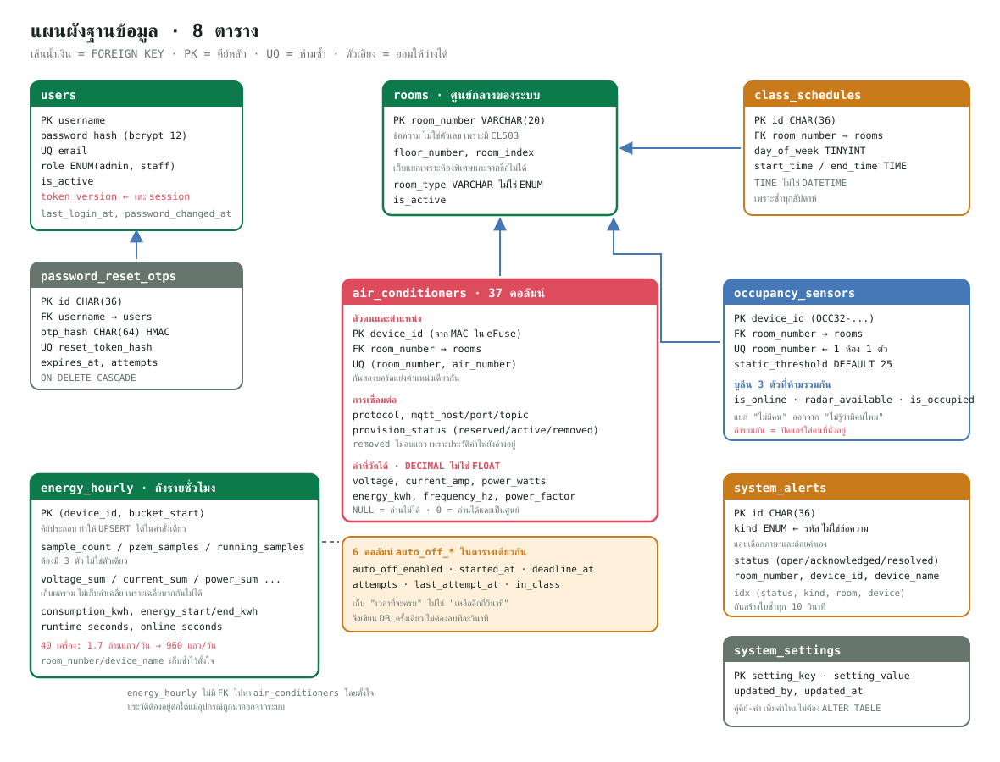

# 01 · ฐานข้อมูล

ฐานข้อมูลคือ MariaDB 11 โครงจริงอยู่ที่ `backend/database/schema.sql`
มีทั้งหมด **8 ตาราง** ไฟล์นี้อธิบายทีละตาราง ทีละคอลัมน์ ว่าทำไมต้องมี



---

## ส่วนที่ 0 · หลักการที่ใช้กับทุกตาราง

ก่อนลงรายตาราง มีกติกาที่ใช้เหมือนกันหมด และมีเหตุผลของมัน

### ทำไมต้อง `ENGINE=InnoDB`

MariaDB เลือก storage engine ได้ ที่เลือก InnoDB เพราะต้องการสองอย่าง

1. **Foreign key** — MyISAM ไม่รองรับเลย ประกาศไปก็เงียบ ๆ ไม่บังคับอะไร
2. **Transaction** — ตอนสร้างผู้ใช้หรือลบแอดมิน ต้องอ่านแล้วเขียนใน
   ธุรกรรมเดียวพร้อม `FOR UPDATE` ไม่งั้นสองคนกดพร้อมกันอาจลบแอดมินคนสุดท้าย

### ทำไมต้อง `utf8mb4` + `utf8mb4_unicode_ci`

- `utf8mb4` = UTF-8 เต็ม 4 ไบต์ **ไม่ใช่ `utf8` ของ MySQL ซึ่งเป็น 3 ไบต์**
  ชื่อวิชาภาษาไทยเก็บได้ทั้งคู่ แต่ถ้ามีอีโมจิหลุดเข้ามาใน `detail`
  หรือชื่อห้องที่ผู้ใช้พิมพ์เอง `utf8` 3 ไบต์จะพังทันที
- `unicode_ci` = เทียบตัวอักษรแบบไม่สนตัวพิมพ์เล็กใหญ่ และเรียงภาษาไทยถูกกว่า
  `general_ci` ผลคือค้นหา `admin` เจอ `Admin` ด้วย ซึ่งเป็นสิ่งที่คนคาดหวัง

### ทำไมทุกตารางมี `created_at` และ `updated_at`

```sql
created_at DATETIME NOT NULL DEFAULT CURRENT_TIMESTAMP,
updated_at DATETIME NOT NULL DEFAULT CURRENT_TIMESTAMP
  ON UPDATE CURRENT_TIMESTAMP
```

`ON UPDATE CURRENT_TIMESTAMP` ทำให้ฐานข้อมูลอัปเดตเวลาให้เอง **โดยที่โค้ดไม่ต้อง
จำ** ถ้าปล่อยให้โค้ดเซ็ตเอง วันหนึ่งจะมีเส้นทางที่ลืมเซ็ต แล้วจะไม่รู้ว่าแถวนั้น
ถูกแก้เมื่อไร เวลาตามหาว่าใครทำอะไรพังจะตันทันที

### ทำไมหลายตารางมี `created_by` และ `updated_by`

เก็บ **username** ของคนที่สร้าง/แก้ล่าสุด ไม่ใช่ id ตัวเลข
เหตุผลเดียวกับที่ `users` ใช้ username เป็น PK (อธิบายด้านล่าง)

ระบบนี้มีแอดมินหลายคน เวลาห้องหายไปหรือแอร์ถูกย้ายตำแหน่ง ต้องตอบได้ว่าใครทำ
ค่า `'system'` ใช้กับข้อมูลที่ seed มาตั้งแต่ติดตั้ง

### ทำไมบางตารางใช้ `CHAR(36)` เป็น PK บางตารางใช้ข้อความจริง

| ตาราง | PK | เหตุผล |
|---|---|---|
| `users` | `username` | เป็นค่าที่คนใช้จริงและไม่ซ้ำอยู่แล้ว |
| `rooms` | `room_number` | เลขห้องคือชื่อจริงของห้อง ไม่มีวันซ้ำในอาคาร |
| `air_conditioners` | `device_id` | มาจาก MAC ของชิป ไม่ซ้ำตั้งแต่โรงงาน |
| `class_schedules` | `id` CHAR(36) | ไม่มีค่าธรรมชาติที่ไม่ซ้ำ ต้องสร้าง UUID เอง |
| `system_alerts` | `id` CHAR(36) | เหมือนกัน |
| `energy_hourly` | `(device_id, bucket_start)` | คีย์ประกอบ อธิบายในหัวข้อของมัน |

**ทำไมไม่ใช้ `AUTO_INCREMENT` ทุกตาราง** — ตัวเลขที่ไล่ขึ้นเรื่อย ๆ มีปัญหาสองข้อ

1. **รั่วข้อมูล** ถ้า API คืน `userId: 42` คนภายนอกเดาได้ว่าระบบมีผู้ใช้ราว 42 คน
   โค้ดฝั่งแอปจึงไม่เคยเห็น id ตัวเลขเลย (`publicUser()` ตัดทิ้งก่อนส่ง)
2. **ต้องรอฐานข้อมูล** ถ้าอยากรู้ id ต้อง insert ก่อนถึงจะได้เลข
   UUID สร้างฝั่งโค้ดได้เลย ทำให้เขียน insert หลายตารางในธุรกรรมเดียวง่ายกว่า

---

## ส่วนที่ 1 · `users` — บัญชีผู้ใช้

```sql
username VARCHAR(100) NOT NULL,
password_hash VARCHAR(255) NOT NULL,
first_name VARCHAR(100) NOT NULL DEFAULT '',
last_name VARCHAR(100) NOT NULL DEFAULT '',
email VARCHAR(190) NOT NULL,
phone VARCHAR(30) NULL,
role ENUM('admin', 'staff') NOT NULL DEFAULT 'staff',
is_active BOOLEAN NOT NULL DEFAULT TRUE,
token_version INT UNSIGNED NOT NULL DEFAULT 0,
last_login_at DATETIME NULL,
password_changed_at DATETIME NULL,
PRIMARY KEY (username),
UNIQUE KEY uq_users_email (email),
KEY idx_users_role_active (role, is_active)
```

### ทีละคอลัมน์

**`username` เป็น PK** — เดิมทีเคยมี `id INT AUTO_INCREMENT` แล้วย้ายมาใช้
username (มี migration `migrate-user-primary-key.js` เป็นหลักฐาน) เพราะ

- ทุกที่ในระบบอ้างถึงคนด้วย username อยู่แล้ว (`created_by`, `acknowledged_by`)
  ถ้า PK เป็นตัวเลข ต้อง JOIN ทุกครั้งที่อยากรู้ว่าใคร
- API ไม่ต้องเปิดเผยตัวเลขภายใน

ข้อเสียคือ **เปลี่ยน username ไม่ได้** ซึ่งยอมรับได้ในบริบทนี้ เพราะ username
คือรหัสพนักงาน/อาจารย์ที่ไม่เปลี่ยน

**`password_hash VARCHAR(255)`** — เก็บผลลัพธ์ของ bcrypt cost 12
ไม่ใช่รหัสผ่านจริง ความยาว 255 เผื่อไว้เพราะ bcrypt ได้ 60 ตัวอักษร
แต่ถ้าวันหนึ่งย้ายไป argon2 จะยาวกว่านั้น เผื่อไว้ไม่เสียหาย

> **ทำไม cost 12** — ยิ่งสูงยิ่งช้าสำหรับคนเดารหัส แต่ก็ช้าสำหรับผู้ใช้จริงด้วย
> cost 12 ใช้เวลาราว 0.2–0.3 วินาทีต่อครั้งบนเครื่องทั่วไป ซึ่งคนไม่รู้สึก
> แต่ทำให้การเดารหัสแบบไล่ทีละตัวช้าลงเป็นล้านเท่าเทียบกับ MD5

**`email` `UNIQUE`** — ต้องไม่ซ้ำเพราะใช้เป็น **ช่องทางกู้รหัสผ่าน**
ถ้าสองบัญชีใช้อีเมลเดียวกัน ระบบจะไม่รู้ว่าต้องส่ง OTP ไปรีเซ็ตบัญชีไหน
ความยาว 190 ไม่ใช่ 255 เพราะ **ข้อจำกัดของ index** — ใน utf8mb4 หนึ่งตัวอักษร
กินได้ถึง 4 ไบต์ index ของ InnoDB จำกัดที่ 767 ไบต์ในบางการตั้งค่า
190 × 4 = 760 ไบต์ ซึ่งยังลอดได้

**`phone VARCHAR(30) NULL`** — เป็น `NULL` ได้เพราะไม่ใช่ข้อมูลจำเป็น
เก็บเป็นข้อความไม่ใช่ตัวเลข เพราะเบอร์โทรมี `0` นำหน้าซึ่งตัวเลขจะกินหาย
และอาจมีเครื่องหมาย `-` หรือรหัสประเทศ `+66`

**`role ENUM('admin','staff')`** — ใช้ ENUM แทนตารางแยกเพราะระบบนี้มีสิทธิ์แค่
สองระดับจริง ๆ และไม่มีแผนจะเพิ่มแบบไดนามิก ENUM ทำให้ฐานข้อมูลปฏิเสธค่าอื่น
ให้เอง เช่นถ้าโค้ดพลาดส่ง `"administrator"` เข้ามาจะ error ทันทีแทนที่จะบันทึก
ค่าเพี้ยนแล้วไปพังตอนเช็คสิทธิ์

**`is_active BOOLEAN`** — แยกจากการลบบัญชี ปิดใช้งานคือ **เก็บประวัติไว้แต่เข้า
ระบบไม่ได้** ซึ่งจำเป็นเพราะ `created_by` ในตารางอื่นยังชี้มาที่ username นี้
ถ้าลบทิ้งเลย ประวัติจะกลายเป็นชื่อลอย ๆ

**`token_version INT UNSIGNED`** — คอลัมน์นี้สำคัญและมักถูกมองข้าม

JWT เป็น token ที่ **เซิร์ฟเวอร์ยกเลิกไม่ได้** เมื่อออกไปแล้วก็ใช้ได้จนหมดอายุ
(8 ชั่วโมง) ปัญหาคือถ้าถอดสิทธิ์แอดมินคนหนึ่ง เขายังใช้ token เดิมสั่งงานได้อีก
8 ชั่วโมง

วิธีแก้คือใส่ `token_version` ลงไปใน token ตอนออก แล้วทุกครั้งที่ตรวจ token
ให้เทียบกับค่าในฐานข้อมูล **ถ้าไม่ตรงถือว่าหมดอายุ** เมื่อเปลี่ยน role
เปลี่ยนรหัสผ่าน หรือปิดบัญชี ก็แค่ `token_version = token_version + 1`
session เดิมทุกเครื่องตายทันทีโดยไม่ต้องเก็บรายการ token ที่ยกเลิกแล้ว

**`last_login_at` / `password_changed_at`** — ใช้ตอบคำถามเชิงดูแลระบบ
เช่น "บัญชีไหนไม่ได้ใช้มานานควรปิด" และ "ใครยังไม่เคยเปลี่ยนรหัสเริ่มต้น"

### ทีละ index

**`idx_users_role_active (role, is_active)`** — มีไว้เพื่อคำถามเดียวที่สำคัญมาก
คือ **"ยังเหลือแอดมินที่ใช้งานได้กี่คน"** ซึ่งถูกถามทุกครั้งที่จะลบหรือถอดสิทธิ์
ใครสักคน ถ้าไม่มี index ต้องสแกนทั้งตาราง

ลำดับคอลัมน์สำคัญ — `(role, is_active)` ใช้ได้กับคำถาม "แอดมินทั้งหมด"
และ "แอดมินที่ยังใช้งานได้" แต่ `(is_active, role)` จะใช้กับคำถามแรกไม่ได้
**หลักคือเอาคอลัมน์ที่กรองแคบกว่าไว้หน้า**

---

## ส่วนที่ 2 · `password_reset_otps` — การกู้รหัสผ่าน

```sql
id CHAR(36) NOT NULL,
username VARCHAR(100) NOT NULL,
otp_hash CHAR(64) NOT NULL,
reset_token_hash CHAR(64) NULL,
expires_at DATETIME NOT NULL,
attempts TINYINT UNSIGNED NOT NULL DEFAULT 0,
verified_at DATETIME NULL,
used_at DATETIME NULL,
CONSTRAINT fk_password_reset_username
  FOREIGN KEY (username) REFERENCES users (username) ON DELETE CASCADE
```

### ทำไมต้องมีตารางแยก ไม่เก็บ OTP ไว้ในแถวของผู้ใช้

เพราะการกู้รหัสผ่านเป็น **กระบวนการที่มีหลายขั้นและอาจเกิดซ้อนกัน**
คนกดขอ OTP สามครั้งติดจะได้สามแถว แถวเก่ายังอยู่ให้ตรวจสอบย้อนหลังได้ว่า
มีใครพยายามกู้รหัสของบัญชีไหนถี่ผิดปกติ

**`otp_hash CHAR(64)` ไม่ใช่ `otp`** — เก็บผลของ `HMAC-SHA256(otp, OTP_PEPPER)`
ไม่ใช่เลข 6 หลักจริง

> **ทำไมต้อง HMAC ไม่ใช่ SHA-256 เปล่า ๆ** — OTP มีแค่ 6 หลัก คือ 1,000,000
> ความเป็นไปได้ ถ้าใช้ hash ธรรมดา คนที่ขโมยฐานข้อมูลไปสร้างตารางเทียบครบทุกค่า
> ได้ในไม่กี่วินาที HMAC ผสม **ความลับที่อยู่ใน `.env` ไม่ได้อยู่ในฐานข้อมูล**
> เข้าไปด้วย คนที่ได้แค่ฐานข้อมูลจึงเทียบกลับไม่ได้
>
> `CHAR(64)` พอดีกับ SHA-256 ที่เขียนเป็นเลขฐานสิบหก (32 ไบต์ × 2)
> ใช้ `CHAR` ไม่ใช่ `VARCHAR` เพราะยาวเท่ากันเสมอ ไม่ต้องเก็บไบต์บอกความยาว

**`reset_token_hash CHAR(64) NULL`** — ขั้นตอนแบ่งเป็นสองท่อน
กรอก OTP ถูก → ได้ reset token → เอา token ไปตั้งรหัสใหม่

ที่ต้องแยกเพราะ **ไม่ควรให้ OTP 6 หลักใช้ตั้งรหัสผ่านได้โดยตรง**
ระหว่างกรอก OTP กับตั้งรหัสใหม่ ผู้ใช้อาจใช้เวลาสักพัก ถ้าใช้ OTP ตลอดทาง
เท่ากับเปิดช่องให้เดา 6 หลักนานขึ้น reset token เป็นค่าสุ่ม 32 ไบต์ซึ่งเดาไม่ได้

**`attempts TINYINT UNSIGNED`** — นับจำนวนครั้งที่กรอก OTP ผิด เกินเกณฑ์แล้วล็อก
`TINYINT` (0–255) พอเหลือเฟือเพราะจะล็อกตั้งแต่ 5 ครั้ง ไม่ต้องใช้ `INT` 4 ไบต์

**`verified_at` กับ `used_at` แยกกัน** — บอกได้ว่ากระบวนการค้างอยู่ขั้นไหน
กรอก OTP ถูกแล้วแต่ยังไม่ตั้งรหัสใหม่ (`verified_at` มี `used_at` ว่าง)
ต่างจากทำครบแล้ว และ `used_at` ทำให้ token ใช้ได้ครั้งเดียว

**`ON DELETE CASCADE`** — ลบผู้ใช้แล้ว OTP ที่ค้างหายตามไปเอง
เป็นที่เดียวในระบบที่ใช้ CASCADE เพราะ OTP **ไม่มีความหมายถ้าไม่มีเจ้าของ**
ต่างจากห้องหรือแอร์ที่ยังมีความหมายในตัวเอง

**`idx_password_reset_expiry (expires_at)`** — มีไว้ให้ลบของหมดอายุทิ้งได้เร็ว

---

## ส่วนที่ 3 · `rooms` — ห้อง

```sql
room_number VARCHAR(20) NOT NULL,
floor_number TINYINT UNSIGNED NOT NULL DEFAULT 0,
room_index SMALLINT UNSIGNED NOT NULL DEFAULT 0,
room_type VARCHAR(100) NOT NULL DEFAULT 'Classroom',
is_active BOOLEAN NOT NULL DEFAULT TRUE,
PRIMARY KEY (room_number),
KEY idx_rooms_floor_active (floor_number, is_active, room_index, room_number)
```

**`room_number VARCHAR(20)` ไม่ใช่ `INT`** — เพราะห้องพิเศษชื่อ `CL503`
ซึ่งมีตัวอักษร ถ้าใช้ตัวเลขจะเก็บไม่ได้เลย และ `16101` ที่เป็นข้อความก็ยัง
เรียงถูกอยู่เพราะทุกห้องมีจำนวนหลักเท่ากัน

**`floor_number` กับ `room_index` ทำไมต้องมีทั้งที่แกะจากเลขห้องได้**

`16103` แกะได้ว่าชั้น 1 ห้องที่ 3 จริง แต่ `CL503` แกะไม่ได้
ถ้าให้โค้ดแกะเอาเอง จะต้องมีเงื่อนไขพิเศษเต็มไปหมด และห้องใหม่ที่ตั้งชื่อไม่ตาม
รูปแบบก็จะพัง เก็บเป็นคอลัมน์แยกทำให้ **ห้องพิเศษเป็นแค่แถวธรรมดา**
(`CL503` มี `floor_number = 0` แปลว่าไม่อยู่ในชั้นปกติ)

`room_index` คือลำดับที่อยากให้แสดงในชั้นนั้น แยกจากเลขห้อง เพราะบางทีอยากให้
ห้องที่ใช้บ่อยขึ้นก่อน โดยไม่ต้องเปลี่ยนเลขห้องจริง

**`room_type VARCHAR(100)` ไม่ใช่ ENUM** — ต่างจาก `role` ตรงที่ประเภทห้อง
**เพิ่มได้เรื่อย ๆ** (`Classroom`, `Laboratory`, `Faculty Office`,
`Network Room`, `Special Computer Laboratory`, …) ถ้าเป็น ENUM ต้อง
`ALTER TABLE` ทุกครั้งที่มีประเภทใหม่ ซึ่งเป็นงาน migration จริง ๆ

**`is_active`** — เหมือน `users` คือซ่อนห้องโดยไม่ลบ เพราะ `air_conditioners`
กับ `class_schedules` ยังอ้างถึงอยู่

### index บอกอะไร

```sql
KEY idx_rooms_floor_active (floor_number, is_active, room_index, room_number)
```

index นี้ตรงกับคำสั่งที่ใช้จริงที่สุดในระบบ คือ
**"เอาห้องที่ใช้งานอยู่ของชั้นนี้ เรียงตามลำดับ"** ซึ่งเป็นสิ่งที่หน้ารายการห้อง
ถามทุกครั้งที่เปิด ทั้งการกรองและการเรียงอ่านจาก index ได้เลย
ฐานข้อมูลไม่ต้องดึงข้อมูลมาเรียงเองในหน่วยความจำ

---

## ส่วนที่ 4 · `class_schedules` — ตารางเรียน

```sql
id CHAR(36) NOT NULL,
room_number VARCHAR(20) NOT NULL,
day_of_week TINYINT UNSIGNED NOT NULL,
subject_name VARCHAR(150) NOT NULL,
section_name VARCHAR(80) NOT NULL DEFAULT '',
instructor VARCHAR(150) NOT NULL DEFAULT '',
start_time TIME NOT NULL,
end_time TIME NOT NULL,
UNIQUE KEY uq_class_schedule_entry
  (room_number, day_of_week, start_time, end_time, subject_name),
KEY idx_class_schedule_lookup (room_number, day_of_week, start_time),
CONSTRAINT fk_class_schedule_room FOREIGN KEY (room_number)
  REFERENCES rooms (room_number) ON UPDATE CASCADE ON DELETE RESTRICT
```

**`day_of_week TINYINT` ไม่เก็บวันที่จริง** — ตารางเรียนเป็นของ **ทุกสัปดาห์**
ถ้าเก็บเป็นวันที่ ต้องสร้างแถวใหม่ทุกสัปดาห์ตลอดภาคเรียน กลายเป็นหลายพันแถว
สำหรับข้อมูลชุดเดียวกัน

**`start_time TIME` ไม่ใช่ `DATETIME`** — ด้วยเหตุผลเดียวกัน `TIME` เก็บแค่
เวลาในวันโดยไม่ผูกกับวันที่ ตรงกับความหมายจริงพอดี และเทียบกับเวลาปัจจุบันได้
โดยไม่ต้องตัดส่วนวันที่ทิ้งก่อน

**ทำไมไม่มีคอลัมน์บอกภาคเรียน** — ระบบนี้ตั้งใจให้ **นำเข้าตารางใหม่ทับของเดิม**
ทุกภาคเรียนผ่านหน้าอิมพอร์ต Excel ประวัติตารางเรียนเก่าไม่ได้ถูกใช้ทำอะไรต่อ
ถ้าวันหนึ่งอยากดูย้อนหลัง จะต้องเพิ่มคอลัมน์ `semester` และแก้ unique key ด้วย

**`uq_class_schedule_entry` ทำไมต้องมี `subject_name` อยู่ในคีย์**

ถ้าไม่ใส่ จะหมายความว่า "หนึ่งห้อง หนึ่งวัน หนึ่งช่วงเวลา มีได้แค่หนึ่งรายการ"
ซึ่งดูสมเหตุสมผล แต่ในทางปฏิบัติห้องแล็บมี **สองวิชาสอนคาบเดียวกันได้**
(แบ่งกลุ่มนักศึกษา) การใส่ชื่อวิชาเข้าไปด้วยทำให้กรณีนี้เก็บได้
แต่ยังกันการนำเข้าไฟล์เดิมซ้ำสองรอบแล้วได้ข้อมูลซ้ำ

**`ON DELETE RESTRICT` ไม่ใช่ CASCADE** — ตั้งใจให้ลบห้องที่ยังมีตารางเรียน
ไม่ได้ เพราะการลบห้องทิ้งแล้วตารางเรียนหายตามเงียบ ๆ เป็นความเสียหายที่กู้ยาก
ผู้ดูแลต้องจัดการตารางเรียนก่อน หรือใช้ `is_active = false` แทน

**`ON UPDATE CASCADE`** — ถ้าเปลี่ยนเลขห้อง ตารางเรียนจะตามไปเอง
กรณีนี้ปลอดภัยเพราะไม่ได้ทำให้ข้อมูลหาย

**`idx_class_schedule_lookup (room_number, day_of_week, start_time)`** —
ตรงกับคำถามที่ระบบถามบ่อยที่สุด **"ตอนนี้ห้องนี้มีคาบเรียนอยู่ไหม"**
ซึ่งถูกถามทุกครั้งที่ ESP32 ส่งสถานะเข้ามา คือหลายครั้งต่อวินาทีเมื่อมีหลายห้อง

---

## ส่วนที่ 5 · `air_conditioners` — เครื่องปรับอากาศ

ตารางที่ใหญ่ที่สุด **37 คอลัมน์** เพราะเก็บของสี่กลุ่มรวมกัน
ขออธิบายแยกเป็นกลุ่ม

### กลุ่ม 1 · ตัวตนและตำแหน่ง

```sql
device_id VARCHAR(32) NOT NULL,     -- ESP32-AABBCCDDEEFF
room_number VARCHAR(20) NOT NULL,
air_number TINYINT UNSIGNED NOT NULL,
name VARCHAR(60) NOT NULL,          -- ชื่อที่คนตั้ง เช่น แอร์ห้องประชุม
ble_name VARCHAR(40) NOT NULL,      -- RMUTT-AC-AABBCCDDEEFF
UNIQUE KEY uq_air_room_number (room_number, air_number),
UNIQUE KEY uq_air_ble_name (ble_name)
```

**`device_id` เป็น PK** — มาจาก MAC ใน eFuse จึงไม่ซ้ำแน่นอน
`VARCHAR(32)` เผื่อไว้ (`ESP32-` 6 + 12 หลัก = 18 ตัว)

**`uq_air_room_number (room_number, air_number)`** — **กันสองบอร์ดแย่งตำแหน่ง
เดียวกัน** ซึ่งเป็นบั๊กที่เจอง่ายมากตอน provisioning ถ้าคนติดตั้งเผลอตั้ง
ห้อง 16103 แอร์ตัวที่ 1 ให้บอร์ดสองตัว ฐานข้อมูลจะปฏิเสธตัวที่สองทันที
แทนที่จะปล่อยให้สองบอร์ดยิง IR ทับกันแล้วมางงทีหลัง

**`ble_name` ต้อง UNIQUE** — เพราะแอปใช้ชื่อ BLE หาบอร์ดตอนสแกน ถ้าซ้ำจะต่อผิดตัว

### กลุ่ม 2 · การเชื่อมต่อและการ provisioning

```sql
protocol VARCHAR(40) NOT NULL DEFAULT 'HAIER_AC160',
mqtt_topic VARCHAR(160) NOT NULL,
mqtt_host VARCHAR(253) NOT NULL,
mqtt_port SMALLINT UNSIGNED NOT NULL DEFAULT 1883,
mqtt_username VARCHAR(100) NULL,
provision_status ENUM('reserved','active','removed') NOT NULL DEFAULT 'reserved',
provisioning_token_hash CHAR(64) NULL,
provisioning_expires_at DATETIME NULL,
UNIQUE KEY uq_air_mqtt_topic (mqtt_topic)
```

**`protocol`** — ยี่ห้อ/รุ่นของสัญญาณ IR ที่ต้องใช้ เก็บเป็นข้อความไม่ใช่ ENUM
เพราะรายการของไลบรารี IRremoteESP8266 ยาวมากและเพิ่มได้ตลอด
ค่าที่รองรับคือชื่อ decode type ตัวพิมพ์ใหญ่ บวกค่าพิเศษ `SAIJO_DENKI`
ที่เขียนไดรเวอร์เอง

**`mqtt_host VARCHAR(253)`** — 253 คือ **ความยาวสูงสุดของชื่อโดเมนตามมาตรฐาน**
ไม่ได้ตั้งมั่ว

**ทำไมเก็บค่า MQTT ไว้ในฐานข้อมูลทั้งที่ `.env` ก็มี** — เพราะค่าที่ส่งให้
**อุปกรณ์** อาจไม่ใช่ค่าที่ **Backend** ใช้ ตอนรันบน Docker
Backend คุยกับ Broker ผ่านชื่อ service ภายในคือ `mqtt://mqtt:1883`
แต่ ESP32 ต้องเข้ามาจากอินเทอร์เน็ตด้วย `mqtts://rmutt-energy.duckdns.org:8883`
การเก็บค่าที่ **ส่งให้บอร์ดจริง** ไว้ในแถว ทำให้ตรวจสอบย้อนหลังได้ว่าบอร์ดนี้
ถูกบอกให้ไปที่ไหน เวลาบอร์ดต่อไม่ได้จะได้รู้ว่าเป็นเพราะค่าเก่าหรือเปล่า

**`provision_status` สามค่า ทำไมไม่ใช้ boolean**

| ค่า | ความหมาย | เกิดตอนไหน |
|---|---|---|
| `reserved` | จองตำแหน่งไว้แล้ว รอบอร์ดมารายงานตัว | แอปกดสร้างในฐานข้อมูล |
| `active` | บอร์ดยืนยันตัวตนแล้ว ใช้งานได้ | บอร์ดส่ง token ที่ถูกต้องมา |
| `removed` | ถูกนำออกจากระบบ | แอดมินสั่งลบ |

**`reserved` มีไว้ปิดช่องว่างระหว่างสองขั้นตอน** — แอปต้องจองตำแหน่งใน
ฐานข้อมูลก่อน (เพื่อขอ token) แล้วค่อยเขียนค่าลงบอร์ดผ่าน BLE ถ้าระหว่างนั้น
มีคนอื่นจองตำแหน่งเดียวกัน จะชนกัน สถานะ `reserved` ทำให้ `uq_air_room_number`
ทำงานตั้งแต่ขั้นจอง

**`removed` ไม่ลบแถวทิ้ง** เพราะ `energy_hourly` ยังมีประวัติค่าไฟของอุปกรณ์นี้
อยู่ ถ้าลบแถวทิ้งจะไม่รู้ว่าประวัตินั้นเป็นของเครื่องไหนห้องไหน
ในหน้าเลือกอุปกรณ์จะขึ้นป้าย `นำออกแล้ว` ให้เลือกดูย้อนหลังได้

**`provisioning_token_hash CHAR(64)`** — เก็บ hash ไม่ใช่ token จริง
ด้วยเหตุผลเดียวกับ OTP คือถ้าฐานข้อมูลรั่ว คนได้ไปก็ปลอมเป็นบอร์ดไม่ได้
มี `provisioning_expires_at` คู่กันเพื่อให้ token ที่ลืมใช้หมดอายุเอง

### กลุ่ม 3 · ค่าที่อุปกรณ์ส่งมา

```sql
is_online BOOLEAN NOT NULL DEFAULT FALSE,
state_json LONGTEXT NULL,
voltage DECIMAL(8,2) NULL,
current_amp DECIMAL(8,3) NULL,
power_watts DECIMAL(10,2) NULL,
energy_kwh DECIMAL(12,3) NULL,
frequency_hz DECIMAL(6,2) NULL,
power_factor DECIMAL(5,3) NULL,
pzem_available BOOLEAN NOT NULL DEFAULT FALSE,
ac_running BOOLEAN NOT NULL DEFAULT FALSE,
outside_schedule BOOLEAN NOT NULL DEFAULT FALSE,
last_seen_at DATETIME NULL
```

**ทำไมใช้ `DECIMAL` ไม่ใช่ `FLOAT`** — นี่เป็นเรื่องสำคัญที่สุดเรื่องหนึ่ง

`FLOAT` และ `DOUBLE` เก็บเลขฐานสองแบบประมาณค่า `0.1 + 0.2` จะไม่เท่ากับ `0.3`
เป๊ะ ๆ ความคลาดเคลื่อนสะสมไปเรื่อย ๆ ระบบนี้ **บวกเลขมิเตอร์ทีละน้อยนับหมื่นครั้ง
ต่อวัน** ถ้าแต่ละครั้งเพี้ยนนิดเดียว ผลรวมของเดือนจะเพี้ยนจนใช้อ้างอิงไม่ได้

`DECIMAL` เก็บเป็นเลขฐานสิบตรง ๆ บวกกี่ครั้งก็ไม่เพี้ยน

**จำนวนหลักเลือกจากความสามารถจริงของ PZEM-004T v3.0**

| คอลัมน์ | ชนิด | เหตุผล |
|---|---|---|
| `voltage` | `DECIMAL(8,2)` | PZEM อ่านได้ 80–260 V ละเอียด 0.1 V |
| `current_amp` | `DECIMAL(8,3)` | อ่านได้ถึง 100 A ละเอียด 0.001 A |
| `power_watts` | `DECIMAL(10,2)` | อ่านได้ถึง 23 kW ละเอียด 0.1 W |
| `energy_kwh` | `DECIMAL(12,3)` | สะสมได้ถึง 9999 kWh ละเอียด 1 Wh เผื่อหลักไว้มาก |
| `frequency_hz` | `DECIMAL(6,2)` | 45–65 Hz ละเอียด 0.1 Hz |
| `power_factor` | `DECIMAL(5,3)` | 0.00–1.00 ละเอียด 0.01 |

ตัวเลขหลัง `,` คือจำนวนทศนิยม เลือกให้ **มากกว่าความละเอียดของเซ็นเซอร์
หนึ่งหลัก** เผื่อการคำนวณ ไม่ใช่ให้น้อยกว่าซึ่งจะตัดข้อมูลทิ้ง

**ทุกค่าวัดเป็น `NULL` ได้** — `NULL` แปลว่า "ยังไม่เคยอ่านได้"
ต่างจาก `0` ที่แปลว่า "อ่านได้ และค่าเป็นศูนย์" ความต่างนี้สำคัญมาก
แอร์ที่ปิดอยู่มี `power_watts = 0` แต่แอร์ที่ PZEM เสียมี `power_watts = NULL`
ระบบปิดอัตโนมัติต้องแยกสองกรณีนี้ให้ออก ไม่งั้นจะคิดว่าแอร์ปิดแล้วทั้งที่
แค่วัดไม่ได้

**`state_json LONGTEXT`** — สถานะรีโมตล่าสุด (อุณหภูมิ โหมด ความแรงพัดลม
สวิง เปิดปิดไฟจอ ฯลฯ) มีเป็นสิบค่าและ **ต่างกันไปตามยี่ห้อ**
แอร์บางรุ่นมี Eco บางรุ่นไม่มี ถ้าแตกเป็นคอลัมน์จะได้คอลัมน์ว่างเต็มไปหมด
และต้อง `ALTER TABLE` ทุกครั้งที่รองรับยี่ห้อใหม่

เก็บเป็น JSON ก้อนเดียวได้เพราะ **ไม่เคยต้องค้นหาด้วยค่าข้างใน**
ไม่มีใครถามว่า "แอร์เครื่องไหนตั้ง 24 องศาบ้าง" ถ้าวันหนึ่งต้องถาม
ค่อยแตกคอลัมน์หรือใช้ JSON index ทีหลังได้

**`ac_running` ทำไมไม่คำนวณจาก `power_watts` ตอนอ่าน**

เพราะการตัดสินว่าแอร์ทำงานจริงต้อง **ดูหลายครั้งติดกัน** (≥30 W สามครั้ง)
คอมเพรสเซอร์แอร์ตัดเข้าตัดออกเป็นช่วง ๆ ถ้าอ่านค่าเดียวแล้วตัดสิน
จะเห็นแอร์ "ปิด" ทุกครั้งที่คอมเพรสเซอร์พัก

การตัดสินใจนี้ทำที่ **เฟิร์มแวร์** เพราะบอร์ดเห็นค่าทุก 2 วินาที
ส่วน Backend เห็นเฉพาะตอนที่บอร์ดส่งมา ฐานข้อมูลจึงเก็บ **ข้อสรุป** ไม่ใช่
วัตถุดิบ ซึ่งลดทั้งปริมาณข้อความและความซับซ้อนฝั่งเซิร์ฟเวอร์

**`is_online` มาจาก LWT ของ MQTT** ไม่ได้คำนวณจาก `last_seen_at`
เพราะ Broker รู้ทันทีที่การเชื่อมต่อขาด ส่วน `last_seen_at` ใช้ตรวจกรณีที่
บอร์ดยังต่ออยู่แต่หยุดส่งข้อมูล ซึ่งเป็นคนละอาการ

### กลุ่ม 4 · สถานะการปิดอัตโนมัติ

```sql
auto_off_enabled BOOLEAN NOT NULL DEFAULT TRUE,
auto_off_started_at DATETIME NULL,
auto_off_deadline_at DATETIME NULL,
auto_off_attempts TINYINT UNSIGNED NOT NULL DEFAULT 0,
auto_off_last_attempt_at DATETIME NULL,
auto_off_in_class BOOLEAN NOT NULL DEFAULT FALSE
```

หกคอลัมน์นี้คือ **เครื่องสถานะของนาฬิกานับถอยหลัง** ที่เก็บลงฐานข้อมูลแทนที่จะ
เก็บในหน่วยความจำของ Node

**ทำไมไม่เก็บในหน่วยความจำ** — เพราะถ้า Backend รีสตาร์ต (deploy ใหม่
คอนเทนเนอร์ถูก restart) นาฬิกาทุกตัวจะหายหมด ห้องที่นับมาแล้ว 4 นาทีจะเริ่มใหม่
และแอปที่กำลังแสดงเวลาอยู่จะเห็นเวลากระโดด

**`auto_off_deadline_at` ทำไมเก็บ "เวลาที่จะครบ" ไม่ใช่ "เหลืออีกกี่วินาที"**

ถ้าเก็บวินาทีที่เหลือ ต้องมีใครสักคนคอยลบทีละวินาที ซึ่งหมายถึงเขียนฐานข้อมูล
ทุกวินาทีต่อทุกเครื่อง — เปลืองมหาศาล

เก็บเป็น **เวลาสิ้นสุด** แทน ฐานข้อมูลเขียนครั้งเดียวตอนเริ่มนับ
ใครอยากรู้ว่าเหลือเท่าไรก็เอาเวลาปัจจุบันไปลบเอง แอปก็เดินนาฬิกาเองในเครื่อง
ได้ทุกวินาทีโดยไม่ต้องยิงถามเซิร์ฟเวอร์

**`auto_off_started_at` ต่างจาก `deadline_at` อย่างไร** — เก็บไว้ตอบว่า
"นับมานานแค่ไหนแล้ว" ซึ่งใช้ตรวจสอบย้อนหลังเวลาระบบทำงานผิดคาด

**`auto_off_attempts` กับ `auto_off_last_attempt_at`** — หลังครบกำหนดแล้ว
ระบบยิง IR ปิด แล้ว **รอดูว่ากำลังไฟตกลงไหม** ถ้าไม่ตกก็ยิงซ้ำ
สองคอลัมน์นี้คุมจังหวะ (ยิงซ้ำทุก 20 วินาที) และจำนวนครั้ง (สูงสุด 5)

ทำไมต้องยิงซ้ำ — เพราะ IR เป็นการสื่อสาร **ทางเดียว ไม่มีการตอบรับ**
อาจมีคนเดินบัง อาจยิงตอนแอร์กำลังประมวลผลคำสั่งอื่น วิธีเดียวที่รู้ว่าสำเร็จ
คือดูว่าไฟตกลงจริงไหม

**`auto_off_in_class`** — จำไว้ว่ารอบนี้เริ่มนับตอนมีคาบเรียนหรือไม่
เพราะเวลานับต่างกัน (15 นาทีในคาบ · 5 นาทีนอกคาบ) ถ้าไม่จำ แล้วคาบเรียนจบลง
ระหว่างนับ เวลาที่เหลือจะกระโดดเปลี่ยนกลางคัน ซึ่งคนดูจะงง

**`auto_off_enabled DEFAULT TRUE`** — ปิดฟีเจอร์รายเครื่องได้ เช่นห้องเซิร์ฟเวอร์
ที่ต้องเปิดแอร์ตลอดแม้ไม่มีคน ค่าเริ่มต้นเป็นเปิดเพราะเป็นจุดประสงค์หลักของระบบ

---

## ส่วนที่ 6 · `occupancy_sensors` — เซ็นเซอร์ตรวจคน

```sql
device_id VARCHAR(32) NOT NULL,
room_number VARCHAR(20) NOT NULL,
static_threshold TINYINT UNSIGNED NOT NULL DEFAULT 25,
is_online BOOLEAN NOT NULL DEFAULT FALSE,
radar_available BOOLEAN NOT NULL DEFAULT FALSE,
is_occupied BOOLEAN NOT NULL DEFAULT FALSE,
UNIQUE KEY uq_occupancy_room (room_number)
```

โครงคล้าย `air_conditioners` มาก (ตัวตน · การเชื่อมต่อ · provisioning)
ขอเน้นเฉพาะที่ต่าง

**`uq_occupancy_room (room_number)` เป็น UNIQUE บนคอลัมน์เดียว** —
**หนึ่งห้องมีเซ็นเซอร์ได้ตัวเดียวเท่านั้น** ต่างจากแอร์ที่มีหลายเครื่องต่อห้อง

ที่บังคับแบบนี้เพราะถ้ามีสองตัวแล้วตอบไม่ตรงกัน (ตัวหนึ่งว่าไม่มีคน อีกตัวว่ามี)
ระบบจะต้องมีกติกาตัดสิน ซึ่งเพิ่มความซับซ้อนโดยไม่จำเป็น
เรดาร์ LD2410 ครอบคลุมได้ราว 6 เมตร ซึ่งพอสำหรับห้องเรียนทั่วไป

**`static_threshold DEFAULT 25`** — เกณฑ์พลังงานนิ่งของเรดาร์
เก็บต่อเซ็นเซอร์เพราะ **ห้องต่างกันต้องการเกณฑ์ต่างกัน** ห้องเล็กเพดานต่ำ
สัญญาณสะท้อนแรงกว่า อาจต้องตั้งสูงขึ้นไม่ให้ตรวจเจอผีตลอดเวลา

**สามคอลัมน์บูลีนที่ต้องแยกกัน** — นี่เป็นจุดออกแบบที่สำคัญมาก

| คอลัมน์ | ตอบคำถาม |
|---|---|
| `is_online` | บอร์ด ESP32 ยังต่อ Broker อยู่ไหม |
| `radar_available` | โมดูล LD2410 ตอบบอร์ดอยู่ไหม |
| `is_occupied` | มีคนในห้องไหม |

ถ้ารวมเป็นคอลัมน์เดียว จะแยกไม่ออกระหว่าง **"ไม่มีคน"** กับ
**"ไม่รู้ว่ามีคนไหม"** ซึ่งต้องปฏิบัติต่างกันโดยสิ้นเชิง

- ไม่มีคน → เริ่มนับถอยหลังปิดแอร์ได้
- ไม่รู้ → **ห้ามปิดเด็ดขาด** เพราะอาจมีคนนั่งอยู่จริง

สถานการณ์จริงที่เกิดขึ้นกับห้อง 16103 คือ `is_online = true` แต่
`radar_available = false` เพราะสาย UART ต่อผิดขา บอร์ดต่อเน็ตได้แต่อ่านเรดาร์
ไม่ได้ ถ้าไม่มีคอลัมน์แยก ระบบจะเห็นเป็น "ไม่มีคน" แล้วสั่งปิดแอร์ใส่คนที่นั่งอยู่

**ทำไมไม่เก็บค่าดิบของเกตทั้ง 9 เกต** — เพราะ

1. ไม่มีหน้าจอไหนแสดงค่าดิบ
2. เกตส่งมา 10 ครั้งต่อวินาที ถ้าเก็บหมดจะได้ข้อมูลมหาศาลที่ไม่มีใครอ่าน
3. การตัดสินใจอยู่ที่บอร์ดอยู่แล้ว (`เกตใดเกตหนึ่ง > 25`)

ฐานข้อมูลเก็บ **ข้อสรุป** เหมือนกรณี `ac_running`

---

## ส่วนที่ 7 · `system_alerts` — การแจ้งเตือน

```sql
id CHAR(36) NOT NULL,
kind ENUM('outside_schedule_occupied','auto_off_succeeded','auto_off_failed') NOT NULL,
room_number VARCHAR(20) NOT NULL,
device_id VARCHAR(32) NULL,
device_name VARCHAR(60) NOT NULL DEFAULT '',
detail VARCHAR(255) NOT NULL DEFAULT '',
status ENUM('open','acknowledged','resolved') NOT NULL DEFAULT 'open',
acknowledged_at DATETIME NULL,
acknowledged_by VARCHAR(100) NULL,
resolved_at DATETIME NULL,
KEY idx_system_alerts_feed (created_at),
KEY idx_system_alerts_open (status, kind, room_number, device_id)
```

### ทำไมเก็บ `kind` เป็นรหัส ไม่เก็บข้อความสำเร็จรูป

นี่คือการตัดสินใจที่ให้ผลดีที่สุดข้อหนึ่งในระบบ

ถ้าเก็บเป็นข้อความว่า `"แอร์ห้อง 16103 ทำงานนอกเวลาเรียน"` จะเจอปัญหาทันที

1. **เปลี่ยนภาษาไม่ได้** ผู้ใช้สลับเป็นอังกฤษแล้วแจ้งเตือนเก่ายังเป็นไทย
2. **แก้ถ้อยคำไม่ได้** อยากปรับข้อความให้เข้าใจง่ายขึ้น ของเก่าก็ยังเป็นแบบเดิม
3. **กรองไม่ได้** จะนับว่ามีแจ้งเตือนชนิดนี้กี่ครั้ง ต้องมาจับคำในข้อความ

เก็บเป็นรหัสแล้วให้ **แอปเป็นคนเลือกถ้อยคำและภาษา** แก้ทีหลังได้โดยไม่ต้อง
แตะข้อมูลเก่าเลย และฟีเจอร์ "เปิดปิดแจ้งเตือนแยกตามชนิด" ที่เพิ่มใน v3.10.0
ทำได้เพราะมีรหัสนี้อยู่แล้ว

**`device_id NULL` ได้** — บางชนิดเป็นเรื่องของทั้งห้อง ไม่ใช่เครื่องใดเครื่องหนึ่ง

**`device_name` เก็บซ้ำทั้งที่ JOIN เอาได้** — ตั้งใจให้ซ้ำ (denormalize)
เพราะถ้าแอร์ถูกเปลี่ยนชื่อหรือนำออกจากระบบ **ประวัติแจ้งเตือนควรยังอ่านรู้เรื่อง**
ว่าตอนนั้นเครื่องชื่ออะไร นี่คือกรณีที่การเก็บซ้ำถูกต้องกว่าการทำ normalize

**`status` สามค่า**

| ค่า | ความหมาย |
|---|---|
| `open` | ต้องมีคนไปจัดการ |
| `acknowledged` | มีคนกดรับทราบแล้ว |
| `resolved` | เงื่อนไขหมดไปเอง หรือเป็นแค่การรายงานผล |

`auto_off_succeeded` ถูกบันทึกเป็น `resolved` **ตั้งแต่แรก** เพราะเป็นข่าวดี
ไม่ต้องให้ใครไปทำอะไรต่อ ส่วน `outside_schedule_occupied` เป็น `open`
และจะกลายเป็น `resolved` เองเมื่อคนออกจากห้องหรือแอร์ถูกปิด

**`idx_system_alerts_open (status, kind, room_number, device_id)`** —
ใช้ตอบคำถาม **"ใบนี้มีอยู่แล้วหรือยัง"** ก่อนสร้างใบใหม่
ถ้าไม่มีการตรวจนี้ ห้องที่เปิดแอร์นอกเวลาทิ้งไว้ทั้งคืนจะสร้างใบแจ้งเตือน
ทุก 10 วินาที คือหลายพันใบต่อคืน

ลำดับคอลัมน์ตรงกับเงื่อนไขที่ใช้ค้นพอดี และเรียงจากที่กรองได้แคบที่สุดก่อน

---

## ส่วนที่ 8 · `energy_hourly` — ถังเก็บค่าไฟรายชั่วโมง

ตารางที่ออกแบบยากที่สุด เพราะต้องเก็บข้อมูลที่ไหลเข้ามาตลอดเวลา
แต่ต้องไม่บวมและต้องสรุปย้อนหลังได้เร็ว

```sql
device_id VARCHAR(32) NOT NULL,
bucket_start DATETIME NOT NULL,
room_number VARCHAR(20) NOT NULL,
device_name VARCHAR(60) NOT NULL DEFAULT '',
sample_count INT UNSIGNED NOT NULL DEFAULT 0,
pzem_samples INT UNSIGNED NOT NULL DEFAULT 0,
running_samples INT UNSIGNED NOT NULL DEFAULT 0,
first_sample_at DATETIME NULL,
last_sample_at DATETIME NULL,
energy_start_kwh DECIMAL(12,3) NULL,
energy_end_kwh DECIMAL(12,3) NULL,
consumption_kwh DECIMAL(12,3) NOT NULL DEFAULT 0,
voltage_sum DECIMAL(16,2) NOT NULL DEFAULT 0,
voltage_min DECIMAL(8,2) NULL,
voltage_max DECIMAL(8,2) NULL,
current_sum ... current_min ... current_max ...
power_sum ... power_min ... power_max ...
power_factor_sum DECIMAL(14,3) NOT NULL DEFAULT 0,
frequency_sum DECIMAL(14,2) NOT NULL DEFAULT 0,
runtime_seconds INT UNSIGNED NOT NULL DEFAULT 0,
online_seconds INT UNSIGNED NOT NULL DEFAULT 0,
PRIMARY KEY (device_id, bucket_start)
```

### แนวคิดหลัก · ทำไมต้องเป็น "ถัง" ไม่ใช่ "บันทึกทุกครั้ง"

ลองคิดเลขก่อน สมมติอาคารมีแอร์ 40 เครื่อง แต่ละเครื่องส่งสถานะทุก 2 วินาที

```
40 เครื่อง × 30 ครั้ง/นาที × 60 นาที × 24 ชั่วโมง = 1,728,000 แถวต่อวัน
```

**เกือบสองล้านแถวต่อวัน** ปีเดียวคือหกร้อยล้านแถว การถามว่า "เดือนที่แล้ว
ห้อง 16103 ใช้ไฟกี่หน่วย" จะต้องอ่านหลายสิบล้านแถว ซึ่งช้าจนใช้ไม่ได้

ถ้าเก็บเป็นถังรายชั่วโมงแทน

```
40 เครื่อง × 24 ชั่วโมง = 960 แถวต่อวัน
```

**ลดลง 1,800 เท่า** และคำถามเดือนที่แล้วอ่านแค่ราว 30,000 แถว

### แนวคิดที่สอง · เก็บ "ผลรวมกับตัวนับ" ไม่เก็บ "ค่าเฉลี่ย"

จุดที่คนมักพลาดคือเก็บค่าเฉลี่ยไว้เลย เช่น `voltage_avg`

ปัญหาคือ **ค่าเฉลี่ยบวกกันไม่ได้** ถ้าชั่วโมงแรกเฉลี่ย 220 V จาก 100 ครั้ง
ชั่วโมงที่สองเฉลี่ย 230 V จาก 10 ครั้ง ค่าเฉลี่ยของสองชั่วโมงรวมกัน
**ไม่ใช่ 225** แต่เป็น `(220×100 + 230×10) / 110 = 220.9`

เก็บ `voltage_sum` กับ `pzem_samples` แทน แล้วหารตอนดึงรายงาน
รวมกี่ชั่วโมงก็ยังถูกเสมอ เพราะผลรวมบวกกันได้ และตัวนับก็บวกกันได้

นี่คือเหตุผลที่มี `..._sum` ห้าตัว (แรงดัน กระแส กำลังไฟ ตัวประกอบกำลัง ความถี่)
คู่กับตัวนับ

### แนวคิดที่สาม · ตัวนับต้องมีสามตัว ไม่ใช่ตัวเดียว

| คอลัมน์ | นับอะไร | ใช้เป็นตัวหารของ |
|---|---|---|
| `sample_count` | ข้อความที่เข้ามาทั้งหมด | การนับว่าอุปกรณ์ส่งถี่แค่ไหน |
| `pzem_samples` | ครั้งที่ PZEM อ่านค่าได้ | ค่าเฉลี่ยแรงดัน กระแส กำลังไฟ |
| `running_samples` | ครั้งที่แอร์ทำงานอยู่ | สัดส่วนเวลาที่แอร์ทำงาน |

ถ้ามีตัวนับตัวเดียว ค่าเฉลี่ยแรงดันจะถูกหารด้วยจำนวนข้อความทั้งหมด
รวมข้อความที่ PZEM อ่านไม่ได้ด้วย ทำให้แรงดันเฉลี่ยต่ำกว่าความจริง

### แนวคิดที่สี่ · เก็บทั้งเลขมิเตอร์และผลต่าง

```sql
energy_start_kwh   -- เลขมิเตอร์ครั้งแรกของชั่วโมงนั้น
energy_end_kwh     -- เลขมิเตอร์ครั้งล่าสุด
consumption_kwh    -- ผลรวมของผลต่างที่คำนวณได้
```

**ทำไมไม่ใช้แค่ `end - start`** — เพราะ PZEM รีเซ็ตเลขมิเตอร์เป็นศูนย์ได้
เมื่อบอร์ดบูตใหม่หรือมีคนสั่งรีเซ็ต ถ้าใช้ `end - start` จะได้ค่าติดลบ

`consumption_kwh` บวกทีละรอบ โดยมีกติกากันเพี้ยนอยู่ใน `energyDelta()`

- **เลขลดลง** (บอร์ดรีเซ็ต) → นับรอบนั้นเป็น 0 ไม่ใช่ค่าติดลบ
- **เลขกระโดดเกิน 50 kWh ในรอบเดียว** → ถือว่าอ่านผิด นับเป็น 0
  เพราะแอร์บ้านไม่มีทางกินไฟ 50 หน่วยในไม่กี่วินาที

เก็บเลขมิเตอร์ต้นและปลายไว้ด้วยเพื่อ **ตรวจสอบย้อนหลัง** ว่าถ้าผลรวมดูแปลก
เกิดจากอะไร

### แนวคิดที่ห้า · `runtime_seconds` กับ `online_seconds`

| คอลัมน์ | นับอะไร |
|---|---|
| `runtime_seconds` | วินาทีที่ **แอร์ทำงานจริง** |
| `online_seconds` | วินาทีที่ **บอร์ดส่งข้อมูลอยู่** |

เอาไว้ตอบคำถามคนละแบบ `runtime` คือ "แอร์เปิดนานแค่ไหน"
ส่วน `online` คือ "ข้อมูลชั่วโมงนี้น่าเชื่อถือแค่ไหน"

ถ้าชั่วโมงหนึ่งมี `online_seconds = 600` จาก 3,600 แสดงว่าบอร์ดหายไป 5 ใน 6
ของชั่วโมง ตัวเลขค่าไฟชั่วโมงนั้นจึงไม่ครบ

**การนับวินาทีมีเพดาน** — `elapsedSeconds()` จำกัดที่ `MAX_SAMPLE_GAP_SECONDS`
= 300 วินาที ถ้าบอร์ดหายไป 3 ชั่วโมงแล้วกลับมา ช่องว่างนั้นจะถูกนับแค่ 5 นาที
ไม่ใช่ 3 ชั่วโมง เพราะเราไม่รู้ว่าระหว่างนั้นแอร์ทำงานอยู่หรือเปล่า
**การเดาว่าทำงานตลอดจะทำให้ตัวเลขสูงเกินจริง**

### `PRIMARY KEY (device_id, bucket_start)` — คีย์ประกอบ

ไม่มี `id` แยก เพราะคู่นี้ **คือตัวตนของแถวอยู่แล้ว** หนึ่งเครื่องต่อหนึ่งชั่วโมง
มีได้แถวเดียว

และที่สำคัญคือมันทำให้ `INSERT ... ON DUPLICATE KEY UPDATE` ทำงานได้
โค้ดไม่ต้องเช็คก่อนว่ามีแถวนี้แล้วหรือยัง แค่ยิง insert ไป
ถ้าชนคีย์ฐานข้อมูลจะบวกค่าเพิ่มให้เอง **ในคำสั่งเดียว**

ถ้าต้อง `SELECT` ก่อนแล้วค่อยตัดสินใจ `INSERT` หรือ `UPDATE` จะเกิด
race condition ทันทีเมื่อมีสองข้อความของเครื่องเดียวกันเข้ามาพร้อมกัน

**ลำดับคอลัมน์ในคีย์** — `device_id` มาก่อน `bucket_start` เพราะคำถามส่วนใหญ่
ระบุอุปกรณ์แล้วค่อยระบุช่วงเวลา และ index หลักของ InnoDB คือตัวเรียงข้อมูลจริง
บนดิสก์ ข้อมูลของเครื่องเดียวกันจึงอยู่ติดกัน อ่านทีเดียวได้

**index เสริมสองตัว**

```sql
KEY idx_energy_hourly_bucket (bucket_start)          -- ทั้งอาคารช่วงนี้
KEY idx_energy_hourly_room (room_number, bucket_start) -- ห้องนี้ช่วงนี้
```

เพราะ PK เรียงตาม `device_id` ก่อน คำถามที่ไม่ระบุอุปกรณ์จึงใช้ PK ไม่ได้
ต้องมี index ที่ขึ้นต้นด้วยสิ่งที่ถามจริง

**`room_number` กับ `device_name` เก็บซ้ำ** ด้วยเหตุผลเดียวกับ `system_alerts`
คือประวัติต้องอ่านรู้เรื่องแม้อุปกรณ์ถูกย้ายห้องหรือนำออกแล้ว
และการ JOIN ทุกครั้งที่ดึงรายงานเดือนละสามหมื่นแถวก็ไม่คุ้ม

### ขนาดตัวเลขของ `..._sum`

```sql
voltage_sum DECIMAL(16,2)   -- ไม่ใช่ DECIMAL(8,2) เหมือนค่าเดี่ยว
power_sum   DECIMAL(18,2)
```

ต้องใหญ่กว่าค่าเดี่ยวมาก เพราะเป็น **ผลรวมของหลายพันครั้ง**
แรงดัน 230 V × 1,800 ครั้งต่อชั่วโมง = 414,000 ซึ่งเกิน `DECIMAL(8,2)`
(สูงสุด 999,999.99) ไปแล้วถ้าส่งถี่กว่านี้ `DECIMAL(16,2)` รองรับได้ถึง
14 หลักหน้าจุด ซึ่งเหลือเฟือ

---

## ส่วนที่ 9 · `system_settings` — ค่าตั้งระดับระบบ

```sql
setting_key VARCHAR(64) NOT NULL PRIMARY KEY,
setting_value VARCHAR(255) NOT NULL,
updated_by VARCHAR(64) NULL,
updated_at TIMESTAMP NOT NULL DEFAULT CURRENT_TIMESTAMP
  ON UPDATE CURRENT_TIMESTAMP
```

ตารางล่าสุด (v3.11.0) เก็บของที่ **กระทบทั้งอาคาร** ตอนนี้มีค่าเดียวคือ
`auto_off_enabled`

**ทำไมเป็นคู่คีย์-ค่า ไม่ใช่คอลัมน์ตายตัว**

ทางเลือกคือทำตารางแถวเดียวที่มีคอลัมน์ละหนึ่งค่าตั้ง ซึ่งอ่านง่ายกว่า
แต่ต้อง `ALTER TABLE` ทุกครั้งที่เพิ่มค่าตั้งใหม่ = ต้องเขียน migration ใหม่ทุกครั้ง

แบบคู่คีย์-ค่าเพิ่มค่าตั้งใหม่ได้โดยแค่ `INSERT` ข้อเสียคือทุกอย่างเป็นข้อความ
ต้องแปลงเองและตรวจเอง ซึ่ง `system-settings.js` ทำผ่าน `parseBoolean()`
ที่รับ `'1'`, `'true'`, `'on'`, `'yes'` ได้หมด

สำหรับระบบที่มีค่าตั้งไม่กี่ตัวและเพิ่มเรื่อย ๆ แบบนี้คุ้มกว่า

**`updated_by` เก็บชื่อคนกด** เพราะเป็นค่าที่ปิดแล้วหยุดทั้งอาคาร
เวลามีคนถามว่าทำไมแอร์ไม่ปิดเอง ต้องตอบได้ว่าใครปิดและปิดเมื่อไร

**`INSERT IGNORE` ตอนสร้างตาราง** ใส่ค่าเริ่มต้น `auto_off_enabled = true`
ให้เลย ถ้ามีค่าอยู่แล้วจะไม่ทับของเดิม ทำให้รัน migration ซ้ำได้ปลอดภัย

---

## ส่วนที่ 10 · การดูแลโครงฐานข้อมูล

### ทำไมมีทั้ง `schema.sql` และ migration script

| ไฟล์ | ใช้ตอนไหน |
|---|---|
| `database/schema.sql` | ติดตั้งใหม่ตั้งแต่ต้น — โครงฉบับสมบูรณ์ |
| `scripts/migrate-*.js` | อัปเกรดฐานข้อมูลที่มีข้อมูลอยู่แล้ว |

ทั้งสองต้องตรงกันเสมอ ถ้าเพิ่มคอลัมน์ใน migration แต่ลืมใส่ใน `schema.sql`
คนที่ติดตั้งใหม่จะได้โครงที่ขาดไป

### `scripts/doctor.js` — ตัวจับความไม่ตรงกัน

เครื่องมือที่แก้ปัญหาข้างบนโดยตรง มันจะ

1. อ่าน `schema.sql` แล้วแกะออกมาว่า **ควรมี** ตารางและคอลัมน์อะไรบ้าง
2. ถามฐานข้อมูลจริงว่า **มีจริง** อะไรบ้าง
3. รายงานส่วนต่าง และถ้าสั่ง `--fix` จะเติมให้

`utils/schema-doctor.js` มีฟังก์ชัน `isAutoAddableColumn()` ที่ตัดสินว่า
คอลัมน์ไหนเติมทีหลังได้ปลอดภัย **คอลัมน์ที่เป็น `NOT NULL` และไม่มีค่าเริ่มต้น
เติมไม่ได้** เพราะแถวเดิมจะไม่มีค่าใส่ ต้องเขียน migration ที่กำหนดค่าเองเท่านั้น

นี่คือเหตุผลที่คอลัมน์ใหม่ ๆ ในระบบนี้มี `DEFAULT` เกือบทั้งหมด

### ลำดับการรัน

```powershell
npm run db:init            # สร้างจาก schema.sql
npm run db:migrate:energy  # v3.7.0
npm run db:migrate:autooff # v3.8.0
npm run db:migrate:settings# v3.11.0
npm run db:doctor -- --fix # ตรวจและเติมที่ขาด
```

ทุก migration เขียนให้ **รันซ้ำได้** (idempotent) ใช้ `CREATE TABLE IF NOT EXISTS`
และเช็คก่อนว่าคอลัมน์มีอยู่แล้วหรือยัง จึงรันสคริปต์อัปเดตซ้ำกี่รอบก็ไม่พัง
