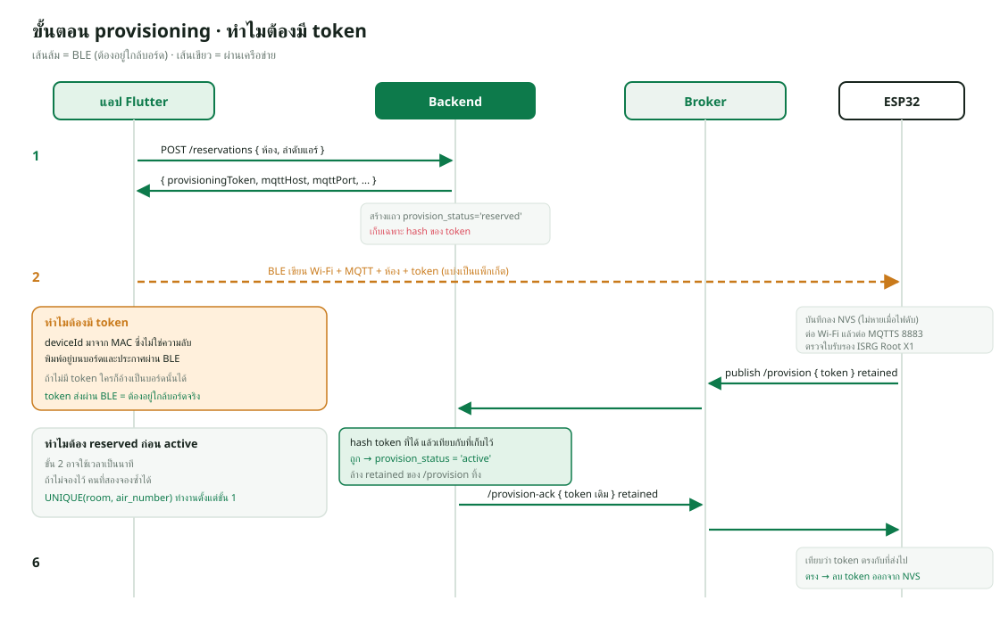

# 05 · MQTT และ BLE — การคุยกับอุปกรณ์

สัญญาฉบับย่ออยู่ที่ `docs/BLE_MQTT_PROTOCOL.md`
ไฟล์นี้อธิบาย **เหตุผล** ที่ออกแบบแบบนั้น



---

## 1. ทำไมต้องใช้สองโปรโตคอล

| โปรโตคอล | ใช้ตอนไหน | ทำไมตัวอื่นไม่ได้ |
|---|---|---|
| **BLE** | ตั้งค่าครั้งแรก | บอร์ดยังไม่รู้ Wi-Fi จึงคุยผ่านเน็ตไม่ได้ |
| **MQTT** | ใช้งานประจำ | BLE ไปได้ไม่เกิน 10 เมตร และแอปต้องเปิดอยู่ |

นี่คือปัญหา **ไก่กับไข่** คลาสสิกของอุปกรณ์ IoT
บอร์ดต้องรู้รหัส Wi-Fi ก่อนถึงจะเข้าเน็ตได้ แต่จะบอกมันได้ก็ต้องคุยกันก่อน

ทางเลือกที่มี

| วิธี | ข้อเสีย |
|---|---|
| เขียนรหัส Wi-Fi ฝังในโค้ด | เปลี่ยนรหัสทีต้องแฟลชใหม่ทุกบอร์ด |
| Wi-Fi AP mode (บอร์ดปล่อยสัญญาณ) | มือถือต้องสลับ Wi-Fi ออกจากเน็ตหลัก ยุ่งมากเมื่อมีหลายสิบตัว |
| **BLE** | ต้องเขียนโค้ดฝั่งแอปเพิ่ม แต่ไม่ต้องสลับเน็ต |

เลือก BLE เพราะตอนติดตั้งจริงคนต้องยืนอยู่ข้างบอร์ดอยู่แล้ว
และไม่ต้องหลุดจากอินเทอร์เน็ตระหว่างตั้งค่า

---

## 2. BLE GATT

### UUID ทั้ง 6 ตัว

| หน้าที่ | UUID | คุณสมบัติ |
|---|---|---|
| Service | `7b570001-a243-4e5b-8f13-179af81b2457` | Primary |
| Config | `7b570002-…` | Write |
| Status/ACK | `7b570003-…` | Read, Notify |
| Identity | `7b570004-…` | Read |
| Nearby Wi-Fi | `7b570005-…` | Read |
| Saved settings | `7b570006-…` | Read |

**ทำไมแยกเป็นหลาย characteristic ไม่ใช้ตัวเดียว** — เพราะทิศทางและจังหวะ
การใช้ต่างกัน

- `Config` เขียนอย่างเดียว และเขียนหลายชิ้น
- `Status` ต้อง **Notify** ได้ เพื่อให้บอร์ดบอกผลกลับมาโดยแอปไม่ต้องคอยถาม
- `Identity` อ่านทันทีที่ต่อ ต้องเร็ว

### `Identity` ทำไมต้องเล็ก

```json
{
  "deviceId": "ESP32-AABBCCDDEEFF",
  "bleName": "RMUTT-AC-AABBCCDDEEFF",
  "firmwareVersion": "1.0.0",
  "configured": false
}
```

เฟิร์มแวร์ 1.6 **ย้ายค่าที่บันทึกไว้ออกไปเป็น characteristic ที่ 6**
เพราะเดิมยัดทุกอย่างไว้ใน Identity แล้ว **Windows WinRT อ่านไม่ทัน timeout**

BLE ส่งข้อมูลได้ทีละ ~20 ไบต์ต่อแพ็กเก็ต payload ที่ใหญ่ต้องแบ่งหลายรอบ
ซึ่งบน Windows ใช้เวลานานกว่า Android มาก การแยกออกทำให้ขั้นตอนแรก
(ยืนยันว่าต่อถูกบอร์ด) จบเร็ว ส่วนค่าที่บันทึกไว้จะอ่านต่อเมื่อจำเป็น

**`Saved settings` ไม่เคยคืนรหัสผ่าน** ทั้ง Wi-Fi และ MQTT
คืนแค่ **ธงบอกว่ามีรหัสตั้งไว้แล้วหรือยัง** เพราะใครก็ตามที่ต่อ BLE ได้
ไม่ควรอ่านรหัส Wi-Fi ของมหาวิทยาลัยออกไป

### `Nearby Wi-Fi` — ทำไมต้องให้บอร์ดสแกนเอง

```json
{ "ok": true, "networks": [["RMUTT-WiFi", -42, true], ["Guest", -68, false]] }
```

คืนไม่เกิน 8 เครือข่าย เรียงจากแรงสุด แต่ละรายการเป็น `[SSID, RSSI, isSecure]`

**ทำไมไม่ให้คนพิมพ์ SSID เอง** — เพราะ **สัญญาณที่มือถือเห็นกับที่บอร์ดเห็น
ไม่เหมือนกัน** คนติดตั้งยืนอยู่กลางห้องมือถือเห็น 4 ขีด
แต่บอร์ดอยู่บนเพดานหลังตู้เหล็กอาจไม่เห็นเลย

การให้บอร์ดสแกนจากตำแหน่งติดตั้งจริงแล้วเลือกจากรายการนั้น
ทำให้รู้ตั้งแต่ก่อนกดยืนยันว่าบอร์ดจะต่อได้หรือไม่ และ `RSSI` บอกด้วยว่า
สัญญาณแรงพอไหม (อ่อนกว่า −75 dBm มักหลุดบ่อย)

ยังกันการพิมพ์ผิดด้วย — SSID ที่พิมพ์ผิดหนึ่งตัวอักษรจะต่อไม่ได้
และหาสาเหตุยากมากเพราะดูเผิน ๆ เหมือนถูก

### รูปแบบแพ็กเก็ต Config

| ไบต์ | ค่า |
|---|---|
| 0 | เวอร์ชันโปรโตคอล (`1`) |
| 1 | ชนิดข้อความ (`1` = config) |
| 2–3 | ลำดับแพ็กเก็ต เริ่มจาก 0 แบบ big-endian |
| 4–5 | จำนวนแพ็กเก็ตทั้งหมด big-endian |
| 6… | ไบต์ JSON แบบ UTF-8 |

**ทำไมต้องแบ่งแพ็กเก็ตเอง** — BLE characteristic มีขนาดจำกัด (มักราว 512 ไบต์
แต่ MTU จริงอาจเหลือ ~20 ไบต์) JSON ของ config ยาวกว่านั้นมาก
เพราะมีทั้ง SSID รหัส Wi-Fi ที่อยู่ MQTT ชื่อผู้ใช้ รหัสผ่าน ห้อง ฯลฯ

**ทำไมต้องมีลำดับและจำนวนรวม** — BLE **ไม่รับประกันลำดับ** ในทุกกรณี
และแพ็กเก็ตอาจหาย บอร์ดต้องรู้ว่าครบหรือยังและเรียงถูกไหม
ก่อนจะลอง `JSON.parse` ซึ่งถ้าไม่ครบจะพังแบบไม่รู้สาเหตุ

**ทำไมไบต์แรกเป็นเวอร์ชัน** — เผื่ออนาคต ถ้าเปลี่ยนรูปแบบ บอร์ดรุ่นเก่า
จะรู้ว่าไม่เข้าใจแล้วปฏิเสธอย่างสุภาพ แทนที่จะพยายามอ่านแล้วได้ค่าเพี้ยน

---

## 3. ขั้นตอน provisioning และเหตุผลของ token

### ลำดับเต็ม

```
1. แอป  →  Backend : POST /api/air-conditioners/reservations
              จองตำแหน่ง (ห้อง, ลำดับแอร์)
   Backend →  แอป   : { provisioningToken, mqttHost, mqttPort, ... }
              สร้างแถว provision_status = 'reserved'
              เก็บ hash ของ token ไม่เก็บ token จริง

2. แอป  →  ESP32 (BLE) : เขียน Wi-Fi + MQTT + ห้อง + token

3. ESP32 : บันทึกลง NVS → ต่อ Wi-Fi → ต่อ MQTTS

4. ESP32 →  Broker : publish /provision { token } แบบ retained

5. Backend : รับ → hash แล้วเทียบกับที่เก็บไว้
              ถูก → provision_status = 'active'
              ส่ง /provision-ack { token } แบบ retained
              ล้าง retained ของ /provision

6. ESP32 : ได้ ack ที่ token ตรงกัน → ลบ token ออกจาก NVS
```

### ทำไมต้องมี token ในเมื่อรู้ `deviceId` อยู่แล้ว

ถ้าไม่มี token ใครก็ตามที่ต่อ Broker ได้ สามารถส่ง `provision` อ้างเป็น
`deviceId` อะไรก็ได้ แล้วยึดตำแหน่งของบอร์ดจริง

`deviceId` มาจาก MAC ซึ่ง **ไม่ใช่ความลับ** มันพิมพ์อยู่บนบอร์ดและ
ประกาศผ่าน BLE ให้ใครก็เห็น

token เป็นค่าสุ่มที่ **Backend เป็นคนสร้าง และส่งให้เฉพาะแอปที่ล็อกอินแล้ว**
บอร์ดได้รับผ่าน BLE ซึ่งต้องอยู่ใกล้กันทางกายภาพ ดังนั้นการมี token ที่ถูกต้อง
พิสูจน์ได้ว่า **มีคนที่มีสิทธิ์ ไปยืนอยู่หน้าบอร์ดนั้นจริง**

### ทำไมต้อง `reserved` ก่อน `active`

ระหว่างขั้น 1 กับขั้น 5 มีช่องว่างเวลาที่คนติดตั้งกำลังเขียนค่าผ่าน BLE
ซึ่งอาจใช้เวลาเป็นนาที

ถ้าไม่สร้างแถวไว้ก่อน คนอีกคนที่กำลังติดตั้งห้องเดียวกันพร้อมกัน
จะจองตำแหน่งซ้ำได้ แล้วค่อยชนกันตอนขั้น 5 ซึ่งตอนนั้นสายไปแล้ว
เพราะบอร์ดทั้งสองตัวถูกตั้งค่าไปแล้ว

สถานะ `reserved` ทำให้ `UNIQUE KEY (room_number, air_number)` ทำงานตั้งแต่
วินาทีแรก คนที่สองจะได้ HTTP `409` **ก่อนที่จะเริ่มเขียน BLE ด้วยซ้ำ**

### ทำไม ack ต้องมี token กลับมาด้วย

ขั้น 6 บอร์ดจะลบ token ออกจาก NVS ก็ต่อเมื่อได้ ack ที่ **token ตรงกัน**

ถ้า ack เป็นแค่ `{"ok": true}` บอร์ดจะลบ token ทิ้งเมื่อได้ข้อความอะไรก็ได้
บนหัวข้อนั้น ซึ่งอาจเป็น retained message เก่าจากการติดตั้งครั้งก่อน
ผลคือบอร์ดคิดว่าสำเร็จแล้วทั้งที่ Backend ยังไม่รู้จักมันเลย

### ทำไมต้องล้าง retained message

```js
export const AIR_RETAINED_SUFFIXES = Object.freeze([
  'command', 'state', 'status', 'provision', 'provision-ack', 'schedule-status',
]);
```

**Retained message อยู่บน Broker ตลอดไปจนกว่าจะมีใครเขียนทับหรือลบ**

ถ้านำอุปกรณ์ออกจากระบบโดยไม่ล้าง แล้ววันหนึ่งเพิ่มบอร์ดที่มี `deviceId`
เดิมกลับเข้ามา (เช่นเอาบอร์ดตัวเดิมไปใช้ใหม่) มันจะได้รับ

- `command` เก่า → **สั่งแอร์ด้วยคำสั่งจากเดือนที่แล้ว**
- `provision` เก่า → Backend เห็น token เก่าแล้วสับสน

การลบทำโดย publish ข้อความว่างพร้อม `retain: true` ไปที่ทุกหัวข้อ

---

## 4. หัวข้อ MQTT

### ฝั่งแอร์ — `rmutt/ac/<deviceId>/...`

| หัวข้อ | ทิศทาง | retained | เนื้อหา |
|---|---|---|---|
| `/command` | Backend → บอร์ด | ใช่ | สถานะที่อยากให้แอร์เป็น |
| `/state` | บอร์ด → Backend | ใช่ | สถานะที่ยิง IR ไปจริง |
| `/status` | บอร์ด → Backend | ใช่ | ออนไลน์ + ค่าจาก PZEM |
| `/provision` | บอร์ด → Backend | ใช่ | token ครั้งเดียว |
| `/provision-ack` | Backend → บอร์ด | ใช่ | ยืนยันพร้อม token เดิม |
| `/schedule-status` | Backend → บอร์ด | ใช่ | ตอนนี้มีคาบเรียนไหม |

### ทำไม `/command` กับ `/state` ต้องแยกกัน

- `/command` = **สิ่งที่อยากให้เป็น** (desired)
- `/state` = **สิ่งที่ทำไปแล้วจริง** (reported)

รูปแบบนี้เรียกว่า **device shadow** หรือ **digital twin**

ถ้ามีหัวข้อเดียว จะแยกไม่ออกว่าข้อความที่เห็น "กำลังจะสั่ง" หรือ "สั่งไปแล้ว"
และเมื่อบอร์ดออฟไลน์แล้วกลับมา มันจะได้ retained ของ `/command`
แล้วทำตามทันที ซึ่งถูกต้อง — แต่ถ้าเป็นหัวข้อเดียวกับ `/state`
มันจะเห็นสถานะของตัวเองแล้วยิง IR ซ้ำโดยไม่มีเหตุผล

### `/status` และ Last Will

```json
{
  "online": true,
  "deviceId": "ESP32-AABBCCDDEEFF",
  "pzemAvailable": true,
  "acRunning": true,
  "outsideSchedule": false,
  "voltage": 229.8, "current": 2.145, "powerWatts": 465.2,
  "energyKwh": 12.345, "frequencyHz": 50.0, "powerFactor": 0.94
}
```

บอร์ดตั้ง **Last Will** ตอนต่อ Broker ว่า "ถ้าฉันหลุด ให้ส่ง
`{"online": false}` ไปที่หัวข้อนี้แทนฉัน"

**ทำไมดีกว่าให้เซิร์ฟเวอร์จับเวลาเอง** — Broker รู้ทันทีที่ TCP ขาด
ส่วนการจับเวลาเองต้องรอ timeout ซึ่งถ้าตั้งสั้นจะ false positive
ตอนเน็ตกระตุก ถ้าตั้งยาวจะรู้ช้า

### `/schedule-status` — ทำไม Backend ต้องบอกบอร์ด

```json
{
  "version": 1,
  "classScheduleConfigured": true,
  "withinClassSchedule": false,
  "evaluatedAt": "2026-08-19T12:00:00.000Z",
  "timezone": "Asia/Bangkok"
}
```

บอร์ดไม่มีตารางเรียนและไม่ควรมี เพราะ

- ตารางเรียนเปลี่ยนทุกภาคเรียน ถ้าเก็บในบอร์ดต้องอัปเดตทุกตัว
- บอร์ดมี RAM จำกัด ตารางเรียนของห้องหนึ่งอาจมีหลายสิบรายการ
- **นาฬิกาของ ESP32 ไม่แม่น** ต้องพึ่ง NTP ซึ่งถ้าเน็ตมีปัญหาจะเพี้ยน

Backend คำนวณตาม `Asia/Bangkok` แล้วส่งผลลัพธ์เป็น boolean ง่าย ๆ ให้
`classScheduleConfigured` แยกต่างหากเพื่อบอกความต่างระหว่าง
"ไม่มีคาบตอนนี้" กับ "ห้องนี้ไม่เคยตั้งตารางเลย"

### ฝั่งเซ็นเซอร์ — `rmutt/occupancy/<deviceId>/...`

มี 4 หัวข้อ (`status`, `provision`, `provision-ack`, `command`)
ไม่มี `/state` เพราะเซ็นเซอร์ไม่มีอะไรให้สั่ง

---

## 5. ACL ของ Broker — ข้อผิดพลาดที่กินเวลามากที่สุด

Mosquitto มีไฟล์ `acl` กำหนดว่าผู้ใช้ไหนเข้าถึงหัวข้อไหนได้

```
user rmutt_air
topic readwrite rmutt/ac/#
topic readwrite rmutt/occupancy/#
```

**ถ้าขาดบรรทัด `rmutt/occupancy/#` ไป** Broker จะ**ปฏิเสธเงียบ ๆ**
ทั้ง publish และ subscribe โดย

- ไม่มี error ในล็อกระดับปกติ
- ไคลเอนต์ยังต่อได้และคิดว่าสำเร็จ
- ข้อความหายไปเฉย ๆ

อาการที่เห็นคือ "เซ็นเซอร์ออนไลน์แต่ไม่มีข้อมูลมาเลย" ซึ่งชี้ไปผิดทางหมด
คนจะไปไล่หาที่สาย UART ที่เฟิร์มแวร์ ที่เน็ต ทั้งที่ปัญหาอยู่ที่ไฟล์ข้อความ
บรรทัดเดียว

**บทเรียน** — เวลาสงสัยว่า MQTT ไม่ทำงาน ให้เปิด log ของ Broker เป็นระดับ
debug และตรวจ ACL เป็นอย่างแรก ไม่ใช่อย่างสุดท้าย

---

## 6. MQTTS พอร์ต 8883

ตอนพัฒนาในเครื่องใช้ `mqtt://` พอร์ต 1883 ธรรมดา
บนเซิร์ฟเวอร์จริงใช้ `mqtts://` พอร์ต 8883 พร้อมใบรับรอง Let's Encrypt

**ทำไมต้องเข้ารหัส** — ถ้าไม่เข้ารหัส

1. **รหัสผ่าน MQTT ส่งเป็น plaintext** ใครดักดูได้ในวง Wi-Fi
2. **คำสั่งเปิดปิดแอร์ถูกดักและปลอมได้** คนนอกสั่งเปิดแอร์ทั้งอาคาร
   ตอนตีสามได้
3. **ค่าไฟของทั้งอาคารรั่ว** ซึ่งบอกได้ว่าห้องไหนมีคนอยู่ตอนไหน

ข้อ 3 เป็นเรื่องความเป็นส่วนตัวที่มักถูกมองข้าม ข้อมูลการใช้ไฟฟ้าบอกรูปแบบ
การใช้ชีวิตได้ละเอียดกว่าที่คิด

**ข้อแลกเปลี่ยน** — TLS บน ESP32 กินหน่วยความจำราว 40 KB ต่อการเชื่อมต่อ
และ handshake ใช้เวลา 1–3 วินาที ซึ่งยอมรับได้เพราะต่อครั้งเดียวแล้วค้างไว้
