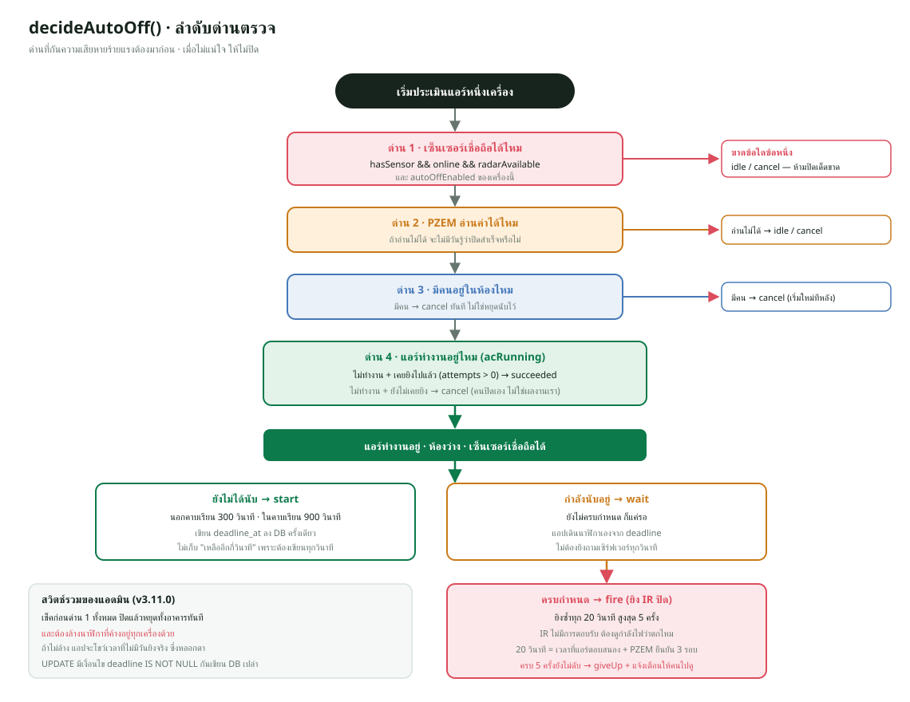

# 06 · ระบบปิดแอร์อัตโนมัติ

หัวใจของโปรเจกต์ ตรรกะอยู่ที่ `backend/src/utils/auto-off.js` (ฟังก์ชันบริสุทธิ์)
และ `backend/src/services/auto-off.js` (ตัวคุมจังหวะ)



---

## 1. โจทย์

> เมื่อแอร์ทำงานอยู่แต่ไม่มีคนในห้อง ให้นับถอยหลัง 5 นาที
> ถ้ายังไม่มีคน ให้ส่งสัญญาณปิด แล้วยืนยันว่าแอร์หยุดจริง

ฟังดูง่าย แต่มีกรณีที่ต้องคิดอย่างน้อย 10 แบบ และ **ความผิดพลาดบางแบบ
ร้ายแรงกว่าแบบอื่นมาก**

| ความผิดพลาด | ผลที่ตามมา |
|---|---|
| ไม่ปิดทั้งที่ควรปิด | เสียค่าไฟ |
| **ปิดทั้งที่ไม่ควรปิด** | **ปิดแอร์ใส่คนที่นั่งอยู่** |

ความไม่สมมาตรนี้กำหนดทุกการตัดสินใจในไฟล์นี้ — **เมื่อไม่แน่ใจ ให้ไม่ปิด**

---

## 2. ทำไมตรรกะต้องอยู่ที่ Backend

เซ็นเซอร์ตรวจคน (`OCC32`) กับบอร์ดแอร์ (`ESP32`) เป็นคนละตัวและคุยกันเองไม่ได้

| บอร์ด | รู้อะไร | ไม่รู้อะไร |
|---|---|---|
| ESP32 แอร์ | แอร์กินไฟอยู่ไหม | มีคนไหม |
| ESP32 ห้อง | มีคนไหม | แอร์ทำงานอยู่ไหม |

จะให้สองบอร์ดคุยกันเองก็ได้ แต่ต้องเขียนโปรโตคอลระหว่างบอร์ดเพิ่ม
และห้องที่มีแอร์สองเครื่องจะต้องกระจายข้อมูลให้ครบทุกตัว
ถ้าตัวใดตัวหนึ่งดับ ตัวที่เหลือจะไม่รู้ว่าควรทำอะไร

**Backend เป็นที่เดียวที่เห็นทั้งสองฝั่งพร้อมกัน** และยังเห็นตารางเรียนด้วย
ซึ่งไม่มีบอร์ดไหนมี

---

## 3. `decideAutoOff()` — ฟังก์ชันตัดสินใจ

```js
export function decideAutoOff({ device, occupancy, withinClass, now })
```

รับสถานะเข้าไป คืน **คำสั่ง** ออกมา ไม่แตะฐานข้อมูล ไม่ส่ง MQTT
ทำให้ทดสอบทุกกรณีได้ในมิลลิวินาที

### คำสั่งที่คืนได้ 7 แบบ

| `action` | ความหมาย | ตัวคุมจังหวะทำอะไรต่อ |
|---|---|---|
| `idle` | ไม่ต้องทำอะไร | ข้ามไป |
| `start` | เริ่มนับถอยหลัง | เขียน `deadline_at` ลงฐานข้อมูล |
| `wait` | กำลังนับอยู่ ยังไม่ครบ | ข้ามไป |
| `fire` | ครบกำหนดแล้ว ให้ยิง IR ปิด | publish คำสั่ง เพิ่ม `attempts` |
| `succeeded` | แอร์หยุดกินไฟแล้ว | ล้างนาฬิกา สร้างใบแจ้งเตือน |
| `giveUp` | ยิงครบแล้วยังไม่ดับ | ล้างนาฬิกา สร้างใบเตือนให้คนไปดู |
| `cancel` | เงื่อนไขหมดไป | ล้างนาฬิกา |

### ลำดับการตรวจ และทำไมต้องเรียงแบบนี้

```js
const sensorUsable = occupancy?.hasSensor === true
  && occupancy?.online === true
  && occupancy?.radarAvailable === true;

// ด่าน 1
if (device?.autoOffEnabled !== true || !sensorUsable) { ... }

// ด่าน 2
if (device?.pzemAvailable !== true) { ... }

// ด่าน 3
if (occupancy.occupied === true) { ... }

// ด่าน 4
if (device?.acRunning !== true) { ... }

// ถึงตรงนี้: แอร์ทำงานอยู่ ห้องว่าง เซ็นเซอร์เชื่อถือได้
```

**ด่านที่กันความเสียหายร้ายแรงต้องมาก่อน** เพราะถ้าตรวจทีหลัง
โค้ดจะมีโอกาสเดินไปถึงจุดที่สั่งปิดก่อนจะรู้ว่าไม่ควรปิด

---

### ด่าน 1 · เซ็นเซอร์ต้องเชื่อถือได้

```js
const sensorUsable = hasSensor && online && radarAvailable;
```

ต้องครบ **ทั้งสามอย่าง**

| ขาด | สถานการณ์จริง |
|---|---|
| `hasSensor` | ห้องยังไม่ได้ติดเซ็นเซอร์ |
| `online` | บอร์ดไฟดับหรือ Wi-Fi หลุด |
| `radarAvailable` | สาย UART หลุด หรือโมดูลเสีย |

**ถ้าขาดข้อใดข้อหนึ่ง = ไม่รู้ว่ามีคนไหม = ห้ามปิดเด็ดขาด**

นี่คือความต่างระหว่าง `false` กับ `unknown` ที่ต้องแยกให้ออก
ถ้าฐานข้อมูลเก็บแค่ `is_occupied` ตัวเดียว ห้อง 16103 ที่สาย UART ต่อผิดขา
จะส่ง `occupied = false` ตลอด แล้วระบบจะปิดแอร์ใส่คนที่นั่งอยู่ทุกวัน

**สังเกตการเขียนเงื่อนไข**

```js
if (device?.autoOffEnabled !== true || !sensorUsable)
```

ใช้ `!== true` ไม่ใช่ `=== false` เพราะ `undefined !== true` เป็นจริง
ถ้าค่าหายไปจากฐานข้อมูลหรือโค้ดส่งไม่ครบ จะได้ผลลัพธ์ปลอดภัย (ไม่ปิด)
แทนที่จะเดินหลุดไป **นี่คือหลัก fail-safe**

### ด่าน 2 · PZEM ต้องอ่านค่าได้

```js
if (device?.pzemAvailable !== true) { ... }
```

**ทำไมสำคัญ** — วิธีเดียวที่รู้ว่าแอร์ปิดแล้วจริงคือดูว่ากำลังไฟตกลง
เพราะ IR เป็นการสื่อสารทางเดียวที่ไม่มีการตอบรับ

ถ้าอ่านไฟไม่ได้ ระบบจะยิงคำสั่งแล้ว **ไม่มีวันรู้ว่าสำเร็จหรือไม่**
กลายเป็นยิงซ้ำครบ 5 ครั้งแล้วสร้างใบแจ้งเตือน `auto_off_failed` ทุกครั้ง
ซึ่งเป็นการรบกวนคนโดยไม่มีประโยชน์

### ด่าน 3 · มีคนอยู่

```js
if (occupancy.occupied === true) {
  return counting ? { action: 'cancel', reason: 'occupied' }
                  : { action: 'idle', reason: 'occupied' };
}
```

`counting` คือ `device.autoOffDeadlineAt != null` แปลว่ากำลังนับอยู่

**มีคนเข้ามากลางคัน → `cancel` ทันที** ไม่ใช่หยุดนับไว้แล้วนับต่อ
เพราะถ้าคนเข้ามาแล้วออกไปอีก ควรเริ่มนับใหม่ 5 นาทีเต็ม
ไม่ใช่เหลือแค่ 30 วินาทีจากรอบก่อน

### ด่าน 4 · แอร์ต้องทำงานอยู่

```js
if (device?.acRunning !== true) {
  if (counting && attempts > 0) {
    return { action: 'succeeded', reason: 'powerDropped', attempts };
  }
  return counting ? { action: 'cancel', reason: 'notRunning' }
                  : { action: 'idle', reason: 'notRunning' };
}
```

**จุดที่ฉลาดที่สุดในไฟล์นี้อยู่ตรงนี้**

`acRunning` เป็น `false` ได้จากสองสาเหตุที่ต่างกันโดยสิ้นเชิง

| กรณี | เงื่อนไข | ควรทำอะไร |
|---|---|---|
| **เราสั่งปิดแล้วมันดับจริง** | `counting && attempts > 0` | **`succeeded`** แจ้งว่าสำเร็จ |
| คนเดินมาปิดเอง / แอร์ปิดอยู่แล้ว | `attempts === 0` | `cancel` เฉย ๆ |

`attempts > 0` คือกุญแจ — แปลว่า **เราเคยยิง IR ไปแล้วอย่างน้อยหนึ่งครั้ง**
ดังนั้นการที่ไฟตกลงตอนนี้เป็นผลจากคำสั่งของเรา

ถ้าไม่แยกสองกรณีนี้ ระบบจะสร้างใบแจ้งเตือน "ปิดแอร์อัตโนมัติสำเร็จ"
ทุกครั้งที่มีคนเดินไปกดปิดเอง ซึ่งเป็นการอ้างเครดิตที่ไม่ได้ทำ
และทำให้สถิติการประหยัดไฟผิด

### การเริ่มนับ

```js
if (!counting) {
  const graceSeconds = withinClass === true
    ? AUTO_OFF_IN_CLASS_SECONDS   // 900
    : AUTO_OFF_IDLE_SECONDS;      // 300
  return {
    action: 'start',
    graceSeconds,
    withinClass: withinClass === true,
    deadlineAt: new Date(current.getTime() + graceSeconds * 1000),
  };
}
```

**ทำไมในคาบเรียนต้องนานกว่า (15 นาที ไม่ใช่ 5)**

ระหว่างคาบเรียนมีเหตุการณ์ปกติที่ทำให้ห้องว่างชั่วคราว

- อาจารย์ให้พัก 10 นาที นักศึกษาออกไปหมด
- อาจารย์ออกไปรับโทรศัพท์ระหว่างที่นักศึกษาทำแบบฝึกหัด
- เรดาร์ตรวจไม่เจอชั่วขณะเพราะทุกคนนั่งนิ่งมากในมุมอับ

ถ้าใช้ 5 นาทีเท่ากัน แอร์จะถูกปิดกลางคาบเรียน ซึ่งเป็นความรำคาญที่ทำให้
คนเลิกใช้ระบบทั้งหมด

นอกเวลาเรียน ห้องว่าง 5 นาทีถือว่าว่างจริงแล้ว

**ค่านี้คือสิ่งที่ผู้ใช้เลือกเอง** — ตอนออกแบบมีสามตัวเลือก
(ไม่ปิดเลยตอนมีคาบ / ปิดเหมือนกัน / ปิดแต่นับนานกว่า)
ผู้ใช้เลือกข้อสาม เพราะห้องที่ลงตารางไว้แต่ไม่มีคนมาเรียนก็ควรปิด

### `withinClass` มาจากไหน — ภาคเรียนและการจองห้อง (อัปเดต 14 ต.ค. 2569)

`readSchedule()` ใน `services/auto-off.js` ไม่ได้ดูแค่ `class_schedules`

```js
const term = await readActiveTermGate();                        // วันเปิด-ปิดภาคเรียน
const bookings = await readTodayBookings(roomNumber, bangkokDate(now));
return withBookings(evaluateClassSchedule(rows, now, { term }), bookings, now);
```

| สถานการณ์ | ผล |
|---|---|
| วันนี้อยู่นอกวันเปิด-ปิดของภาคเรียนที่ตารางปัจจุบันเป็นของมัน (`termStatus` = `before`/`after`) | **ถือว่านอกคาบทุกห้อง** ห้องว่างช่วงปิดภาคจึงถูกปิดใน 5 นาที โดยไม่ต้องลบตารางทิ้ง |
| ภาคเรียนไม่ได้ตั้งวันไว้ หรือยังไม่มีตาราง `academic_terms` | ใช้ตารางทุกวันเหมือนเดิม (`termStatus` = `none`) |
| มีการใช้ห้องที่จองไว้ (`room_bookings` ประชุม สอบ กิจกรรม) ครอบเวลาตอนนี้ | **ถือว่าอยู่ในคาบ** (รอ 15 นาที และไม่แจ้งเตือน) แม้อยู่นอกภาคเรียน |

ภาคเรียนของตารางปัจจุบันจำไว้ใน `system_settings` ตอนนำเข้าตารางเรียน
ถ้านำเข้าแบบ "เปลี่ยนภาคเรียน" (`replaceAll`) ตารางเดิม **ทุกห้อง** ถูกล้างก่อน
ห้องที่เทอมก่อนมีเรียนแต่ไม่อยู่ในไฟล์ใหม่จึงไม่ค้างตารางเก่า
(ไม่งั้นระบบจะคิดว่ายังมีคาบ รอ 15 นาทีแทน 5 และไม่แจ้งเตือน)

ผลเดียวกันนี้ถูกส่งให้บอร์ดแอร์ทาง `/schedule-status` ด้วย (ดู `05-mqtt-ble.md`)
ตั้งแต่ 9 ต.ค. แอปมือถือจัดการการจองห้องและปฏิทินภาคเรียนได้เหมือนเว็บแอป
(ดู `03-flutter-app.md`)

### การยิงซ้ำ

```js
if (current.getTime() < deadline.getTime()) {
  return { action: 'wait', secondsRemaining: secondsBetween(current, deadline) };
}

if (attempts >= AUTO_OFF_MAX_ATTEMPTS) {          // 5
  return { action: 'giveUp', reason: 'stillRunning', attempts };
}

if (elapsed < AUTO_OFF_RETRY_SECONDS) {           // 20
  return { action: 'wait', secondsRemaining: Math.ceil(20 - elapsed) };
}

return { action: 'fire', attempts: attempts + 1 };
```

**ทำไมต้องยิงซ้ำ** — IR ไม่มีการตอบรับ คำสั่งอาจไม่ถึงเพราะ

- มีคนเดินบังตัวส่งพอดี
- ยิงตอนแอร์กำลังประมวลผลคำสั่งอื่น
- ระยะไกลเกินหรือมุมไม่ตรง

**ทำไมต้องเว้น 20 วินาที ไม่ยิงรัว**

แอร์ใช้เวลาสักพักกว่าคอมเพรสเซอร์จะหยุดหลังรับคำสั่ง และ PZEM ต้องอ่านค่าใหม่
อีกหลายรอบกว่าจะสรุปว่า `acRunning = false` (ต้อง ≤10 W ติดกัน 3 ครั้ง)
ถ้ายิงรัวทุกวินาที จะยิงครบ 5 ครั้งก่อนที่แอร์จะมีโอกาสตอบสนองด้วยซ้ำ

**ทำไมหยุดที่ 5 ครั้ง**

5 ครั้ง × 20 วินาที = 100 วินาที ถ้าแอร์ยังไม่ดับใน 100 วินาที
แปลว่ามีปัญหาจริง เช่นตัวส่ง IR เสีย หรือโปรโตคอลตั้งผิดยี่ห้อ
การยิงต่อไปเรื่อย ๆ ไม่ช่วยอะไร แต่จะทำให้ไม่มีใครรู้ว่ามีปัญหา

จึงเลิกยิงแล้ว **สร้างใบแจ้งเตือนให้คนไปดู** ซึ่งเป็นการแก้ที่ถูกจุดกว่า

---

## 4. `services/auto-off.js` — ตัวคุมจังหวะ

### สามทางกระตุ้น

```js
unsubscribeAir = onAirStatus(({ deviceId }) => runEvaluation(deviceId));
unsubscribeOccupancy = onOccupancyStatus(({ roomNumber }) => {
  if (roomNumber) runEvaluation(null, roomNumber);
});
timer = setInterval(() => runEvaluation(), TICK_INTERVAL_MS);  // 10 วินาที
```

| ทาง | ทำไมต้องมี |
|---|---|
| สถานะแอร์เปลี่ยน | แอร์เพิ่งเปิด → เริ่มนับได้ทันที ไม่ต้องรอ 10 วินาที |
| สถานะคนเปลี่ยน | คนเดินเข้ามา → ยกเลิกทันที ไม่ให้เห็นนาฬิกาเดินต่อ |
| ตัวจับเวลา | **ถ้าไม่มีอะไรเปลี่ยนเลยก็ยังต้องยิงเมื่อครบกำหนด** |

ข้อสามสำคัญที่สุดและมักถูกลืม — ห้องที่แอร์เปิดค้าง ไม่มีคน สถานะเดิมทุกครั้ง
จะไม่มีเหตุการณ์อะไรเกิดขึ้นเลย ถ้าพึ่งแต่เหตุการณ์ นาฬิกาจะเดินจนครบแล้ว
ไม่มีใครมาดู

### ธงกันทำงานซ้อน

```js
let running = false;

export async function evaluateAutoOff({ deviceId, roomNumber, now } = {}) {
  if (running) return [];
  running = true;
  try {
    ...
  } finally {
    running = false;
  }
}
```

สามทางข้างบนอาจกระตุ้นพร้อมกัน (เช่นบอร์ดแอร์กับบอร์ดห้องส่งสถานะมาพร้อมกัน
ตอนที่ timer ก็ยิงพอดี) ถ้าปล่อยให้ทำงานซ้อน จะเกิด

- ยิงคำสั่งปิดสองครั้งในรอบเดียว
- `auto_off_attempts` เพิ่มสองเด้ง ทำให้ครบ 5 เร็วเกินจริง

**`finally` สำคัญ** ถ้าโค้ดข้างในโยน error แล้วไม่คืนธง ระบบจะค้างถาวร

### `unref()` — เพื่อให้เทสต์จบได้

```js
if (typeof timer.unref === 'function') timer.unref();
```

บอก Node ว่า **timer นี้ไม่ใช่เหตุผลที่ต้องรันต่อ**
ถ้าไม่มีบรรทัดนี้ `node --test` จะค้างไม่จบ เพราะยังมี timer เดินอยู่

เช็ค `typeof` ก่อนเพราะในบางสภาพแวดล้อม (เช่นเบราว์เซอร์) ไม่มีเมธอดนี้

---

## 5. สวิตช์รวม (v3.11.0)

```js
if (!(await isAutoOffEnabled())) {
  await clearAllCountdowns();
  return [];
}
```

เช็คเป็น **อย่างแรกของทุกรอบ** ก่อนอ่านรายการอุปกรณ์ด้วยซ้ำ

### ทำไมต้องล้างนาฬิกาด้วย ไม่ใช่แค่ return

ถ้าแค่ `return` นาฬิกาที่ค้างอยู่จะยังอยู่ในฐานข้อมูล และ **แอปจะยังโชว์เวลา
นับถอยหลังที่ไม่มีวันยิงจริง** ซึ่งหลอกตาคนใช้ให้คิดว่าระบบยังทำงาน

```sql
UPDATE air_conditioners
   SET auto_off_started_at = NULL, auto_off_deadline_at = NULL,
       auto_off_attempts = 0, auto_off_last_attempt_at = NULL,
       auto_off_in_class = 0
 WHERE auto_off_deadline_at IS NOT NULL
```

**เงื่อนไข `IS NOT NULL` สำคัญ** — ทำให้รอบที่ไม่มีอะไรค้างไม่เขียนฐานข้อมูลเลย
ตัวคุมจังหวะเรียกทุก 10 วินาที ถ้าเขียนทุกรอบจะกวนฐานข้อมูลเปล่า ๆ ตลอดเวลา

### การพักค่า 5 วินาที

```js
const CACHE_TTL_MS = 5000;
```

ตัวคุมจังหวะเรียกทั้งทุก 10 วินาทีและทุกครั้งที่บอร์ดส่งสถานะเข้ามา
ซึ่งอาจหลายครั้งต่อวินาทีเมื่อมีหลายสิบเครื่อง
ถ้าอ่านฐานข้อมูลทุกครั้งจะเปลืองโดยไม่ได้อะไร

5 วินาทีสั้นพอที่คนกดสวิตช์แล้วเห็นผลเกือบทันที

### ถอยกลับเมื่อยังไม่ได้ migrate

```js
} catch (error) {
  if (error?.code !== 'ER_NO_SUCH_TABLE') throw error;
}
```

ถ้าตาราง `system_settings` ยังไม่มี (ยังไม่ได้รัน migration)
ให้ถอยไปใช้ค่าเริ่มต้นคือ **เปิด** แทนที่จะล้มทั้งตัวคุมจังหวะ

**ทำไมค่าเริ่มต้นเป็นเปิด ไม่ใช่ปิด** — เพราะระบบนี้คือเหตุผลหลักของโปรเจกต์
ถ้าอัปเดตเซิร์ฟเวอร์แล้วระบบหยุดทำงานเงียบ ๆ จะดูเหมือนพัง
และกว่าจะรู้ว่าแค่ลืมเปิดอาจกินเวลาหลายวัน

---

## 6. การแสดงผลฝั่งแอป

### ทำไมเก็บ "เวลาที่จะครบ" ไม่ใช่ "เหลืออีกกี่วินาที"

ฐานข้อมูลเก็บ `auto_off_deadline_at` เป็นเวลาสิ้นสุด

ถ้าเก็บวินาทีที่เหลือ ต้องมีใครคอยลบทีละวินาที = เขียนฐานข้อมูล
ทุกวินาทีต่อทุกเครื่อง ซึ่งเปลืองมหาศาล

เก็บเป็นเวลาสิ้นสุดแทน ฐานข้อมูลเขียน **ครั้งเดียว** ตอนเริ่มนับ
ใครอยากรู้ว่าเหลือเท่าไรก็เอาเวลาปัจจุบันไปลบเอง

**แอปจึงเดินนาฬิกาเองได้ทุกวินาที** โดยไม่ต้องยิงถามเซิร์ฟเวอร์
`widgets/auto_off_countdown.dart` มี `Timer.periodic` ในตัว
คำนวณจาก deadline ที่ได้มาตอนรีเฟรชล่าสุด

### นาฬิกาอยู่ที่การ์ดห้อง ไม่ใช่แค่รายเครื่อง

`rooms_screen.dart`

```dart
if (room.isAutoOffPending) ...[
  AutoOffCountdown(
    key: const Key('room-auto-off-countdown'),
    deadline: room.autoOffDeadlineAt,   // MIN ของทุกเครื่องในห้อง
    compact: true,
  ),
],
```

API `/api/rooms` คืน `MIN(auto_off_deadline_at)` ของแอร์ทุกเครื่องในห้อง

**ทำไมใช้ MIN** — เพราะแอร์แต่ละเครื่องถูกประเมินแยกกัน อาจเริ่มนับคนละเวลา
การ์ดห้องควรแสดงเวลาของ **เครื่องที่จะครบกำหนดก่อน** เพื่อบอกว่า
"อีกเท่าไรจะเริ่มมีอะไรเกิดขึ้นในห้องนี้"

---

## 7. กติกาแจ้งเตือน

### ข้อ 1 · แอร์ทำงานนอกเวลาเรียนและมีคนอยู่

`outside_schedule_occupied` เป็นใบ `open` ที่ต้องมีคนกดรับทราบ
หรือปิดเองเมื่อเงื่อนไขหมดไป

**ทำไมต้องมีคนอยู่ด้วย** — ถ้าไม่มีคน ระบบก็ปิดให้เองอยู่แล้ว ไม่ต้องรบกวนใคร
แจ้งเตือนนี้มีไว้สำหรับกรณีที่ **ระบบปิดให้ไม่ได้เพราะมีคนอยู่**
แต่ก็ไม่ใช่เวลาที่ควรใช้ห้อง

**ข้อจำกัดที่รู้อยู่** — ห้องที่ไม่เคยตั้งตารางเรียนเลย (เช่นห้องทำงาน
ห้องเซิร์ฟเวอร์) จะเข้าเงื่อนไขนี้ตลอดเวลาที่มีคนและเปิดแอร์
คอลัมน์ `detail` แยกไว้ให้ (`noScheduleAtAll` กับ `noClassNow`
และ `outsideTerm` เมื่ออยู่นอกวันเปิด-ปิดภาคเรียน)
ถ้าพบว่าน่ารำคาญ ให้กรองห้องประเภทสำนักงานออกภายหลัง

### ข้อ 2 · ปิดสำเร็จ

`auto_off_succeeded` บันทึกเป็น `resolved` ตั้งแต่แรก เพราะเป็นการรายงานผล
ไม่ต้องให้ใครไปทำอะไรต่อ

### ข้อ 3 · ปิดไม่สำเร็จ

`auto_off_failed` เป็นใบ `open` ต้องมีคนไปดูว่าตัวส่ง IR เสียหรือตั้งโปรโตคอลผิด

### การปิดใบเก่าอัตโนมัติ

```js
await resolveOpenAlerts({
  kind: ALERT_KINDS.AUTO_OFF_FAILED,
  roomNumber, deviceId,
});
```

เมื่อปิดสำเร็จ ใบ `auto_off_failed` เก่าของเครื่องเดียวกันจะถูกปิดให้เอง
เพราะปัญหาหมดไปแล้ว ไม่ควรให้คนมานั่งกดปิดใบที่ไม่เป็นปัญหาแล้ว

---

## 8. สรุปค่าคงที่ และที่มา

```js
export const AUTO_OFF_IDLE_SECONDS = 300;      // 5 นาที
export const AUTO_OFF_IN_CLASS_SECONDS = 900;  // 15 นาที
export const AUTO_OFF_RETRY_SECONDS = 20;
export const AUTO_OFF_MAX_ATTEMPTS = 5;
const TICK_INTERVAL_MS = 10_000;
```

| ค่า | ที่มา |
|---|---|
| 300 วินาที | ผู้ใช้กำหนด — นานพอที่คนเดินไปเข้าห้องน้ำแล้วกลับมา |
| 900 วินาที | ผู้ใช้เลือก — ครอบคลุมช่วงพักกลางคาบ |
| 20 วินาที | เวลาที่แอร์ต้องใช้ตอบสนอง + PZEM ยืนยัน 3 รอบ |
| 5 ครั้ง | 100 วินาทีรวม ถ้าไม่ดับแปลว่ามีปัญหาจริง |
| 10 วินาที | ละเอียดพอสำหรับนาฬิกาหน่วยนาที แต่ไม่กวนฐานข้อมูล |

**แก้ค่าเหล่านี้ที่ `utils/auto-off.js` ที่เดียว** แล้วเทสต์จะจับให้เองว่า
มีอะไรพังไหม
