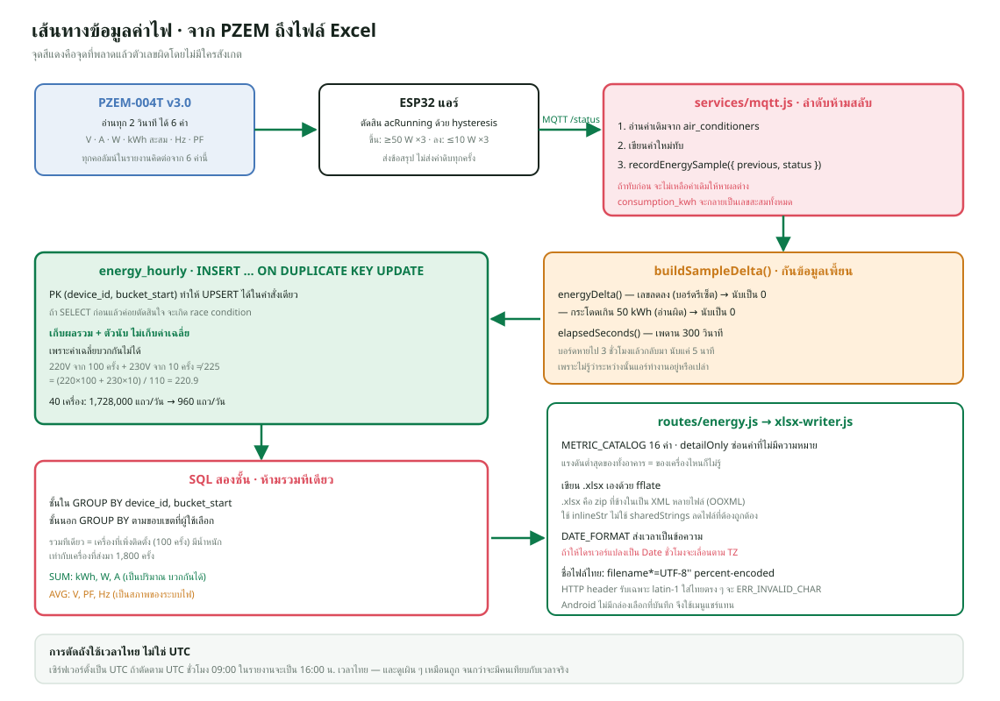

# 07 · ระบบค่าไฟและการส่งออก Excel

โค้ดหลัก — `utils/energy-history.js` (24 KB) · `services/energy-recorder.js` ·
`routes/energy.js` (18 KB) · `utils/xlsx-writer.js`



---

## 1. PZEM-004T ให้อะไรมาบ้าง

**6 ค่า เท่านั้น**

| ค่า | หน่วย | ความหมาย |
|---|---|---|
| Voltage | V | แรงดันไฟฟ้า |
| Current | A | กระแสที่ไหลผ่าน |
| Power | W | กำลังไฟจริง (active power) |
| Energy | kWh | **เลขมิเตอร์สะสม** ตั้งแต่เริ่มนับ |
| Frequency | Hz | ความถี่ไฟฟ้า |
| Power Factor | — | ตัวประกอบกำลัง 0.00–1.00 |

**ทุกคอลัมน์ในรายงานคำนวณต่อจาก 6 ค่านี้** ไม่มีค่าไหนที่เซ็นเซอร์ไม่ได้ให้มาจริง

### `Power` กับ `Energy` ต่างกันอย่างไร

- `Power` = **อัตรา** ณ ขณะนี้ (เหมือนมาตรวัดความเร็วรถ)
- `Energy` = **ปริมาณสะสม** (เหมือนเลขไมล์)

ค่าไฟที่ต้องจ่ายคิดจาก `Energy` ไม่ใช่ `Power`
แต่ `Power` ใช้ตัดสินว่าแอร์ทำงานอยู่ไหม เพราะเห็นผลทันที

### ทำไม Power Factor สำคัญ

แอร์เป็นโหลดแบบ **inductive** (มีมอเตอร์) ทำให้กระแสกับแรงดันไม่ตรงเฟสกัน

```
กำลังไฟปรากฏ (VA) = V × A
กำลังไฟจริง (W)   = V × A × PF
```

ถ้า PF = 0.6 แปลว่ากระแสที่ไหลในสายมากกว่าที่ควรเป็นถึง 1.67 เท่า
สายไฟร้อนกว่า เบรกเกอร์ทำงานหนักกว่า แต่ค่าไฟคิดจาก W

**PF ต่ำผิดปกติจึงเป็นสัญญาณว่าแอร์มีปัญหา** เช่นคาปาซิเตอร์เสื่อม
รายงานจึงมีคอลัมน์นี้ให้เลือกในโหมดรายละเอียดสูง

---

## 2. เส้นทางข้อมูลหนึ่งรอบ

```
ESP32 อ่าน PZEM ทุก 2 วินาที
   ↓ MQTT /status
services/mqtt.js
   ↓ 1. อ่านค่าเดิมจาก air_conditioners  ← สำคัญมาก ต้องทำก่อน
   ↓ 2. เขียนค่าใหม่ทับ
   ↓ 3. recordEnergySample({ previous, status })
utils/energy-history.js : buildSampleDelta()
   ↓ คำนวณผลต่างและเวลาที่ผ่านไป
services/energy-recorder.js
   ↓ INSERT ... ON DUPLICATE KEY UPDATE
energy_hourly (1 แถวต่อเครื่องต่อชั่วโมง)
   ↓
routes/energy.js : /summary /history /export
   ↓
แอป
```

### ลำดับข้อ 1–3 ห้ามสลับ

```js
const previous = await readCurrentRow(deviceId);   // ต้องก่อน
await updateRow(deviceId, status);                 // แล้วค่อยทับ
await recordEnergySample({ previous, status });    // ใช้ค่าเดิมหาผลต่าง
```

ถ้าเขียนทับก่อน จะไม่เหลือค่าเดิมให้หาผลต่าง
`consumption_kwh` จะกลายเป็น **เลขสะสมทั้งหมดตั้งแต่ติดตั้ง** ไม่ใช่ของชั่วโมงนั้น
และตัวเลขจะบวมขึ้นเรื่อย ๆ อย่างน่ากลัว

---

## 3. การตัดถังรายชั่วโมง

```js
export function bangkokHourStart(date) { ... }
```

**ทำไมต้องตัดตามเวลาไทย ไม่ใช่ UTC**

เซิร์ฟเวอร์อยู่ต่างประเทศ ตั้งเป็น UTC ตามมาตรฐาน
ถ้าตัดถังตาม UTC "ชั่วโมง 9 โมง" ในฐานข้อมูลจะเป็น 16:00 น. เวลาไทย

ผู้ใช้ที่ดูรายงานคาดหวังว่า `09:00-10:00` คือเก้าโมงเช้าตามเวลาที่เขาอยู่
ถ้าเพี้ยนไป 7 ชั่วโมง ทุกอย่างจะอ่านไม่รู้เรื่อง — และที่แย่กว่าคือ
**ดูเผิน ๆ เหมือนถูก** จนกว่าจะมีคนเทียบกับเวลาจริง

### ทำไมส่งออกเป็นข้อความ ไม่ใช่ `Date`

```sql
DATE_FORMAT(t.bucket_start, '%Y-%m-%d %H:%i:%s') AS bucket_start
```

ถ้าปล่อยให้ไดรเวอร์ mariadb แปลงเป็น `Date` ของ JavaScript
มันจะตีความตาม timezone ของ **Node process** ซึ่งอาจไม่ตรงกับของ **MariaDB**

ผลคือชั่วโมงเลื่อนไปโดยไม่มีใครสังเกต เพราะไม่มี error อะไรเลย

การส่งเป็นข้อความตัดปัญหานี้ทิ้งทั้งหมด — ตัวเลขที่อยู่ในฐานข้อมูลคือตัวเลข
ที่ไปถึงแอป ไม่มีการแปลงระหว่างทาง

---

## 4. `buildSampleDelta()` — หัวใจของการบันทึก

### `energyDelta()` — กันข้อมูลเพี้ยน

```js
const MAX_ENERGY_JUMP_KWH = 50;

export function energyDelta(previous, current) {
  if (previous == null || current == null) return 0;
  const diff = current - previous;
  if (diff < 0) return 0;                    // บอร์ดรีเซ็ต
  if (diff > MAX_ENERGY_JUMP_KWH) return 0;  // อ่านผิด
  return diff;
}
```

**กรณีที่ 1 · เลขลดลง**

PZEM รีเซ็ตเลขมิเตอร์เป็นศูนย์เมื่อบอร์ดบูตใหม่หรือมีคนสั่งรีเซ็ต
ถ้าปล่อยให้ติดลบ ผลรวมของชั่วโมงนั้นจะติดลบ และผลรวมของเดือนจะน้อยกว่าจริง

**กรณีที่ 2 · เลขกระโดดเกิน 50 kWh ในรอบเดียว**

แอร์บ้านกินไฟราว 1–2 kW ต่อชั่วโมง การจะกิน 50 หน่วยในไม่กี่วินาที
เป็นไปไม่ได้ทางกายภาพ ค่านี้จึงมาจากการอ่านผิด เช่นสัญญาณ UART รบกวน

**ทำไมคืน 0 ไม่ใช่โยน error** — เพราะข้อมูลผิดหนึ่งรอบไม่ควรทำให้ระบบหยุด
การข้ามรอบนั้นทำให้เสียข้อมูลไม่กี่วินาที ซึ่งยอมรับได้
ส่วน `energy_start_kwh` และ `energy_end_kwh` ยังเก็บเลขมิเตอร์จริงไว้
ให้ตรวจสอบย้อนหลังได้ว่าเกิดอะไรขึ้น

### `elapsedSeconds()` — เพดานเวลา

```js
const MAX_SAMPLE_GAP_SECONDS = 300;
```

ถ้าบอร์ดหายไป 3 ชั่วโมงแล้วกลับมา ช่องว่างนั้นจะถูกนับแค่ **5 นาที**
ไม่ใช่ 3 ชั่วโมง

**ทำไม** — เพราะเราไม่รู้ว่าระหว่างนั้นแอร์ทำงานอยู่หรือเปล่า

- ถ้าเดาว่าทำงานตลอด → `runtime_seconds` สูงเกินจริงมาก
- ถ้าเดาว่าไม่ทำงาน → ต่ำเกินจริง

การจำกัดที่ 5 นาทีคือการยอมรับว่า **ไม่รู้** แล้วเลือกค่าที่ผิดน้อยที่สุด
พร้อมกับให้ `online_seconds` บอกว่าข้อมูลชั่วโมงนั้นครบแค่ไหน

---

## 5. `energy_hourly` — เก็บผลรวม ไม่เก็บค่าเฉลี่ย

(อธิบายละเอียดใน `01-database.md` ขอสรุปเหตุผลอีกครั้งเพราะสำคัญ)

**ค่าเฉลี่ยบวกกันไม่ได้**

```
ชั่วโมงที่ 1 : เฉลี่ย 220 V จาก 100 ครั้ง
ชั่วโมงที่ 2 : เฉลี่ย 230 V จาก  10 ครั้ง

ผิด  : (220 + 230) / 2 = 225
ถูก  : (220×100 + 230×10) / 110 = 220.9
```

ถ้าเก็บ `voltage_avg` ไว้เลย การรวมหลายชั่วโมงจะผิดเสมอ
เก็บ `voltage_sum` กับ `pzem_samples` แล้วหารตอนดึงรายงาน รวมกี่ชั่วโมงก็ถูก

---

## 6. SQL สองชั้น — จุดที่พลาดง่ายที่สุด

```sql
SELECT ... FROM (
  -- ชั้นใน: สรุปต่ออุปกรณ์ต่อชั่วโมงก่อน
  SELECT device_id, bucket_start,
         SUM(consumption_kwh)  AS kwh,
         SUM(voltage_sum)      AS v_sum,
         SUM(pzem_samples)     AS v_cnt
    FROM energy_hourly h
   WHERE ...
   GROUP BY device_id, bucket_start
) t
-- ชั้นนอก: รวมตามขอบเขตที่ผู้ใช้เลือก
GROUP BY t.bucket_start
```

### ทำไมรวมทีเดียวไม่ได้

สมมติห้องหนึ่งมีแอร์ 2 เครื่อง ในชั่วโมงเดียวกัน

| เครื่อง | แรงดันเฉลี่ย | จำนวนครั้ง |
|---|---|---|
| A | 230 V | 1,800 |
| B | 225 V | 100 (เพิ่งติดตั้ง) |

**ถ้ารวมทีเดียว** ด้วย `AVG(voltage_sum / pzem_samples)`
จะได้ `(230 + 225) / 2 = 227.5` ซึ่งให้น้ำหนักเครื่อง B เท่ากับเครื่อง A
ทั้งที่ B มีข้อมูลน้อยกว่า 18 เท่า

**ชั้นในสรุปต่อเครื่องก่อน** แล้วชั้นนอกจึงรวม ทำให้ถ่วงน้ำหนักถูกต้อง

### ค่าไหนใช้ SUM ค่าไหนใช้ AVG

| ประเภท | ค่า | เหตุผล |
|---|---|---|
| **SUM** | พลังงาน (kWh), กำลังไฟ (W), กระแส (A) | เป็นปริมาณ บวกกันได้ตามฟิสิกส์ |
| **AVG** | แรงดัน (V), ตัวประกอบกำลัง, ความถี่ (Hz) | เป็นสภาพของระบบไฟ ไม่ใช่ปริมาณ |

**ทำไมแรงดันห้าม SUM** — แอร์สองเครื่องในห้องเดียวกันต่อไฟจากสายเดียวกัน
ทั้งคู่เห็นแรงดัน 230 V ผลรวมคือ 460 V ซึ่ง **ไม่มีความหมายทางฟิสิกส์เลย**
ไม่มีจุดไหนในวงจรที่มีแรงดัน 460 V

ส่วนกระแส 2 A + 3 A = 5 A มีความหมายจริง คือกระแสรวมที่ไหลผ่านสายเมน

---

## 7. `METRIC_CATALOG` — 16 ค่าที่เลือกได้

```js
{
  key: 'voltageAvg',
  labelTh: 'แรงดันเฉลี่ย (V)',
  labelEn: 'Average voltage (V)',
  unit: 'V',
  decimals: 1,
  inner: 'SUM(voltage_sum) AS voltage_sum, SUM(pzem_samples) AS pzem_samples',
  group: '...',
  detailOnly: true,
  default: false,
}
```

**ทำไมทำเป็นแคตตาล็อกแทนที่จะเขียน SQL แยกทุกกรณี**

ผู้ใช้เลือกได้ 16 ค่า × 3 ขอบเขต × 2 ระดับรายละเอียด = ชุดที่เป็นไปได้เยอะมาก
ถ้าเขียน SQL ไว้ล่วงหน้าทุกชุดจะมีหลายสิบคำสั่งที่ต้องดูแลให้ตรงกัน

แคตตาล็อกเก็บ **ชิ้นส่วน SQL** ของแต่ละค่าไว้ แล้ว `buildHistorySql()`
ประกอบเฉพาะที่ผู้ใช้เลือก

**`detailOnly: true`** — บางค่ามีความหมายเฉพาะตอนดูรายเครื่องหรือรายห้อง
เช่น `แรงดันต่ำสุด` ของทั้งอาคารคือแรงดันต่ำสุดของเครื่องไหนก็ไม่รู้
ซึ่งไม่มีประโยชน์ ธงนี้ซ่อนค่าพวกนั้นในโหมดสรุป

**`labelTh` กับ `labelEn` แยกกัน** — หัวคอลัมน์ในไฟล์ Excel ต้องตรงกับ
ภาษาที่ผู้ใช้เลือกในแอป ไม่ได้ไปผ่านระบบแปลของ Flutter เพราะสร้างที่ Backend

---

## 8. สามระดับรายละเอียด

| ขอบเขต | หนึ่งแถวคือ | ปลดล็อกอะไร |
|---|---|---|
| `ทั้งอาคาร` | หนึ่งชั่วโมง | — |
| `แยกตามห้อง` | หนึ่งห้องต่อหนึ่งชั่วโมง | เลือกห้อง + ค่า detailOnly |
| `แยกตามเครื่องแอร์` | หนึ่งเครื่องต่อหนึ่งชั่วโมง | เลือกเครื่อง + ค่า detailOnly |

โหมด `ทั้งอาคาร` ออกแบบให้ตรงกับ **ไฟล์ตัวอย่างที่ทางคณะใช้กันอยู่เดิม**
(`data` / `time` เช่น `15:00-16:00` / `พลังงานที่ใช้/kWh`)
เพื่อให้เอาไปต่อกับงานเดิมได้ทันทีโดยไม่ต้องแปลงรูปแบบ

---

## 9. เขียนไฟล์ `.xlsx` เอง

`utils/xlsx-writer.js` เขียนไฟล์ Excel เองด้วย `fflate` (บีบอัด zip)
ไม่ใช้ไลบรารีสำเร็จรูปอย่าง `exceljs`

### ทำไมเขียนเอง

| เหตุผล | รายละเอียด |
|---|---|
| ขนาด | `exceljs` ลากมาหลายสิบ MB ส่วน `fflate` ไม่กี่ร้อย KB |
| ควบคุมได้ | รู้ทุกไบต์ที่เขียน แก้ปัญหาความเข้ากันได้ตรงจุด |
| ความเสี่ยง | dependency น้อยลง = ช่องโหว่น้อยลง |

### `.xlsx` คืออะไรจริง ๆ

**ไฟล์ zip ที่ข้างในเป็น XML หลายไฟล์** ตามมาตรฐาน OOXML

```
[Content_Types].xml     บอกว่าไฟล์ไหนเป็นชนิดอะไร
_rels/.rels             ความสัมพันธ์ระดับราก
xl/workbook.xml         รายชื่อแท็บ
xl/worksheets/sheet1.xml  ข้อมูลจริง
xl/styles.xml           รูปแบบ
```

### `inlineStr` ไม่ใช่ `sharedStrings`

Excel ปกติเก็บข้อความไว้ในไฟล์ `sharedStrings.xml` แล้วในเซลล์อ้างด้วยหมายเลข
ซึ่งประหยัดพื้นที่เมื่อมีข้อความซ้ำเยอะ

โปรเจกต์นี้ใช้ `inlineStr` (เขียนข้อความลงในเซลล์ตรง ๆ) เพราะ

- รายงานส่วนใหญ่เป็นตัวเลข ข้อความซ้ำมีน้อย
- **ลดไฟล์ที่ต้องเขียนและต้องทำให้ถูกต้องไปหนึ่งไฟล์**
- ไม่ต้องจัดการตารางดัชนีข้อความซึ่งพลาดแล้วไฟล์เปิดไม่ได้

### บทเรียนจากการเขียนเอง

**`zipSync` ล้มด้วย `date not in range 1980-2099`**

เกิดจากตั้ง `mtime: 0` ซึ่งแปลว่าปี 1970 — นอกช่วงที่รูปแบบ zip รองรับ
(zip เก็บวันที่แบบ MS-DOS ซึ่งเริ่มนับจากปี 1980)

แก้โดยไม่ส่ง `mtime` เลย ให้ใช้เวลาปัจจุบัน

**openpyxl บอกว่า `Workbook contains no default style`**

ไฟล์เปิดใน Excel ได้ แต่ไลบรารี Python อ่านไม่ได้ เพราะ `styles.xml`
ขาดส่วน `<cellStyles>` และ `<dxfs count="0"/>`

Excel ใจกว้างกว่ามาตรฐาน แต่เครื่องมืออื่นไม่ **จึงต้องทดสอบด้วยเครื่องมือ
ที่เข้มงวดกว่า** ไม่ใช่แค่เปิดใน Excel แล้วผ่าน

---

## 10. ชื่อไฟล์ภาษาไทยใน HTTP header

```
Content-Disposition: attachment; filename="energy.xlsx";
  filename*=UTF-8''%E0%B8%84%E0%B9%88%E0%B8%B2%E0%B9%84%E0%B8%9F.xlsx
X-Export-Filename: %E0%B8%84%E0%B9%88%E0%B8%B2%E0%B9%84%E0%B8%9F.xlsx
```

**ปัญหา** — HTTP header รองรับเฉพาะอักษร latin-1 ถ้าใส่ภาษาไทยตรง ๆ
Node จะโยน `ERR_INVALID_CHAR` ทันที

**วิธีแก้** — RFC 5987 กำหนดรูปแบบ `filename*=UTF-8''<percent-encoded>`
ไว้สำหรับกรณีนี้พอดี

`asciiFileName()` สร้างชื่อสำรองเป็นอักษรละตินไว้ใน `filename=` ธรรมดา
สำหรับไคลเอนต์เก่าที่ไม่รู้จัก `filename*`

`X-Export-Filename` เป็น header ที่เพิ่มเอง เพราะแอป Flutter อ่านค่าจาก
`Content-Disposition` ได้ไม่สะดวกในทุกแพลตฟอร์ม

---

## 11. การบันทึกไฟล์ฝั่งแอป

`lib/utils/file_saver.dart` ทำงานต่างกันสองแพลตฟอร์ม

| แพลตฟอร์ม | วิธี | ทำไม |
|---|---|---|
| Windows | `file_selector.getSaveLocation()` | ผู้ใช้เลือกที่เก็บได้ตามปกติ |
| Android | เขียนลงพื้นที่ชั่วคราว แล้ว `share_plus` | **Android ไม่มี "กล่องเลือกที่บันทึก" แบบเดสก์ท็อป** |

บน Android แอปไม่มีสิทธิ์เขียนที่ไหนก็ได้ วิธีมาตรฐานคือเปิดเมนูแชร์
ให้ผู้ใช้เลือกเองว่าจะส่งไปแอปไหน (Drive, Gmail, ไฟล์ ฯลฯ)

ต้องเพิ่ม dependency สองตัวคือ `path_provider` (หาที่เก็บชั่วคราว)
และ `share_plus` (เปิดเมนูแชร์)

---

## 12. การแสดงผลฝั่งแอป

### หน่วยอัตโนมัติ

```dart
EnergyDisplay formatEnergy(double kwh, {double? scaleReference})
```

| ช่วง | หน่วย |
|---|---|
| < 1 kWh | `Wh` |
| 1–999 kWh | `kWh` |
| ≥ 1000 kWh | `MWh` |

**ที่มาของฟีเจอร์นี้** — ผู้ใช้ลองวัดที่ชาร์จมือถือ (21 W) ค่าจริง `0.005 kWh`
ถูกปัดเหลือ `0.0 kWh` ทุกจุดบนกราฟ อ่านอะไรไม่ได้เลย

### หน่วยร่วมของทั้งชุด

```dart
final reference = energyScaleReference(values);   // ค่าสูงสุดของชุด
formatEnergy(value, scaleReference: reference)
```

ถ้าปล่อยให้แต่ละจุดเลือกหน่วยเอง `900 Wh` จะไปอยู่ข้าง `1.2 kWh`
แล้วเลข 900 จะดูใหญ่กว่าทั้งที่น้อยกว่า **กราฟที่ทำให้เข้าใจผิด
แย่กว่าไม่มีกราฟ**

ใช้หลักเดียวกันกับการ์ดแยกตามห้องในหน้าสถิติ
